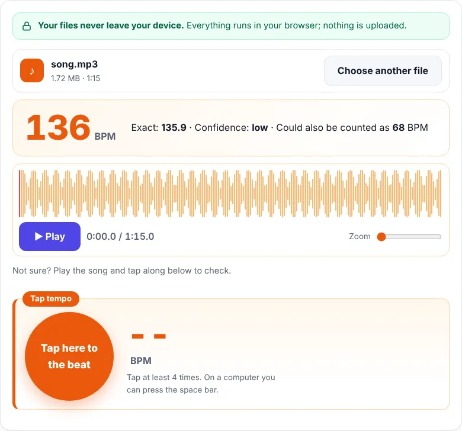

BPM means beats per minute: how many beats a song has in one minute. Dancers use it to plan steps, DJs use it to mix two songs, gym trainers use it to pick workout music, and musicians use it to set a metronome. You can find it in your browser from the song file itself, or by tapping along while the song plays.

> **Short answer:** open [BPM Finder](/bpm-finder/), click **Choose a song** and pick your MP3, WAV or M4A file. After a few seconds the BPM appears in large numbers. To check by ear, play the song and tap the **Tap here to the beat** button (or press the space bar) along with the beat.

## How to find the BPM from a song file

1. Open **[BPM Finder](/bpm-finder/)** on your phone or computer.
2. Click **Choose a song** and pick the audio file. MP3, WAV, M4A, AAC, OGG, FLAC and WMA files work, and so does the sound from many video files.
3. Wait a few seconds while the tool reads the file and shows **Finding the beat**.
4. The BPM appears in large numbers. Below it you see the **Exact** value with one decimal and a **Confidence** of high, medium or low.
5. If the song feels slower or faster than that number, look at **Could also be counted as**. It shows half and double the tempo.
6. A waveform of the song appears below the result, so you can play it and check.

The tool looks at the first two minutes of the song, which is enough for most tracks. To check a later part, such as a fast ending, cut that part out first with [MP3 Cutter](/mp3-cutter/) and then choose the shorter file.

## How to find the BPM by tapping

Tap tempo works when you do not have the file, for example a song playing on YouTube, the radio or another phone. It also helps when the confidence shows low.

1. Open [BPM Finder](/bpm-finder/). The **Tap tempo** box is below the file picker.
2. Play the song.
3. Tap the **Tap here to the beat** button in time with the beat. On a computer you can press the **space bar** instead.
4. Tap at least 4 times. The BPM shows the average of your recent taps, with the exact value and the number of taps.
5. Keep tapping for a few more beats to get a steadier number.
6. Click **Reset** to start again. If you stop for more than 2.5 seconds, the next tap starts a new count by itself.

Tap on the beat you would clap to, not on every small sound in the music.

## Which number is the real BPM

A song with a slow, heavy beat at 70 BPM often has drums playing twice as fast, so it can also be counted as 140 BPM. Neither number is wrong. Both the file check and your tapping can land on either one.

| What you see | What it means | What to do |
|---|---|---|
| Confidence high | The beat is clear and steady | Use the number |
| Confidence medium | The beat is there but not very strong | Tap along to confirm |
| Confidence low | No clear drums, or the tempo changes | Use tap tempo instead |
| Number feels too fast | The tool counted the small beats | Use the half value |
| Number feels too slow | The tool counted every second beat | Use the double value |

Pick the value that matches how people would clap, walk or dance to the song.

## Typical BPM by type of music

These are typical ranges, not rules, and plenty of songs fall outside them.

| Type of music | Typical tempo |
|---|---|
| Dub | 60 to 90 BPM |
| Hip hop | 60 to 100 BPM |
| House | 115 to 130 BPM |
| Techno and trance | 120 to 140 BPM |
| Dubstep | 135 to 145 BPM |
| Drum and bass | 160 to 180 BPM |

Source: Ableton's [Learning Music](https://learningmusic.ableton.com/make-beats/tempo-and-genre.html) lessons. Film songs and folk music cover a wide range, so check each song on its own.

## What to do after you know the BPM

- To slow a song down for dance practice or speed it up for a workout, use [Audio Speed Changer](/audio-speed-changer/). See the [change audio speed guide](/guides/how-to-change-audio-speed/) for the steps.
- To make a song fit your singing range without changing its speed, use [Pitch Changer](/pitch-changer/). The [change pitch guide](/guides/how-to-change-pitch-of-song/) explains how.
- Keep only the part you need for a performance or reel with [MP3 Cutter](/mp3-cutter/).
- To tune an instrument before you practise, [Tone Generator](/tone-generator/) plays a steady tone at the frequency you choose, such as A 440 Hz.

## Why the BPM may look wrong

- The song has no drums. Soft songs, ghazals and instrumental pieces with only a slow melody have no clear beat to find. Tap along instead.
- The tempo changes. Live recordings and many film songs speed up or slow down. The tool gives one number for the first two minutes, so a later part may be different.
- There is a long intro. If the song starts with a slow alaap or talking, cut it off with MP3 Cutter and check again.
- The file will not open. Some files are damaged or use an unusual format. Convert it to MP3 with [Audio Converter](/audio-converter/) first.
- Your taps are uneven. Tap for longer, because one early or late tap changes the average less when there are more taps.
