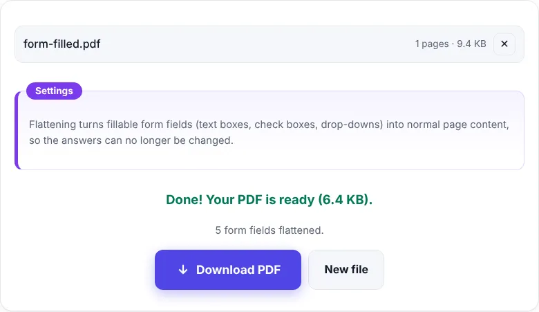

You filled a PDF form, and now you want to send it so that nobody can change your answers. Maybe it is a rent agreement form, a club membership form or an office declaration. The answer is to **flatten** the PDF. Flattening turns the fillable boxes into normal page content, so the text stays exactly where you typed it but can no longer be edited.

> **Short answer:** fill and save the form, then open [Flatten PDF](/flatten-pdf/), choose the file, click **Flatten PDF** and download the locked copy.

## Fillable form vs flattened PDF

| | Fillable form | Flattened PDF |
|---|---|---|
| Can you type in the boxes? | Yes | No |
| Can someone change your answers? | Yes, with any PDF reader | Not by typing in boxes |
| Looks the same in every app? | Not always, some apps hide field values | Yes |
| Prints correctly? | Usually, but some printers skip fields | Yes |
| Can you undo it? | Not needed | No, keep the original |

Some phone apps, upload portals and printers do not show the values inside form fields. After flattening, your answers become part of the page itself, so they show up everywhere.

## How to flatten a PDF form

1. **Fill the form and save it.** If you need a free way, use [PDF Form Filler](/pdf-form-filler/) and tap **Save filled PDF**.
2. Open **[Flatten PDF](/flatten-pdf/)**.
3. Click **Choose PDF file** or drag the filled PDF into the box.
4. Click **Flatten PDF**.
5. Read the message. It tells you how many form fields were flattened, for example "5 form fields flattened".
6. Click **Download PDF**.

The new file has **flattened** at the end of its name. Your original PDF is not changed, so keep it in case you need to fix a mistake later. The work happens inside your browser and the file is not uploaded.

If the message says **no fillable form fields were found**, the PDF has no boxes to lock. It may be a scanned form or a form that was already flattened, and it is saved unchanged.

## Fill and flatten in one go

If you are filling the form on ZentaPDF anyway, you can skip the second step. In [PDF Form Filler](/pdf-form-filler/), tick **Lock the answers (flatten)** before you tap **Save filled PDF**. Our guide on [filling a PDF form on your phone](/guides/how-to-fill-pdf-form-on-phone/) shows every step.

## What gets flattened and what does not

| Item | Flattened? |
|---|---|
| Text boxes (name, address, dates) | Yes |
| Check boxes and radio buttons | Yes |
| Drop-down lists | Yes |
| Comments and sticky notes | No, they stay as they are |
| Text you added with an editor as normal page text | Already part of the page |
| Scanned forms (just pictures of paper) | Nothing to flatten |

## Flatten using Print to PDF (another way)

You can also flatten a filled form with the print option on your computer:

1. Open the filled PDF in Chrome, Edge or Adobe Acrobat Reader.
2. Press **Ctrl + P** to print.
3. Choose **Save as PDF** or **Microsoft Print to PDF** as the printer, then save.

The new copy usually has the answers as plain page content. This method redraws the whole file, so links and bookmarks may be lost and text quality can change. Flatten PDF changes only the form fields and keeps the rest of the file as it was.

## When you should flatten a PDF

- **Before sending a filled form** by email or WhatsApp, so the answers are not changed by mistake.
- **Before uploading a form to a portal** that shows empty boxes when you preview it.
- **Before printing**, so every answer appears on paper.
- **Before merging** the form with other documents using [Merge PDF](/merge-pdf/), so the fields do not clash.

## Things to know before you flatten

- **Keep the original.** Flattening cannot be undone in a simple way.
- **Digitally signed PDFs:** do not flatten or edit a PDF that already has a digital signature, for example one signed with a DSC. Any change after signing can make the signature show as invalid. Flatten first, then sign.
- **Sign after flattening.** To add a handwritten style signature, use [Sign PDF](/sign-pdf/). See our guide on [signing a PDF without printing](/guides/how-to-sign-pdf-without-printing/).
- **Flattening is not a password.** Someone with a PDF editor can still cover or change page content. To stop others from opening the file, add a password with [Protect PDF](/protect-pdf/).
- **Official forms:** some offices ask for the form in a particular way, such as printed and signed by hand. Read the instructions that came with the form before you flatten it.
