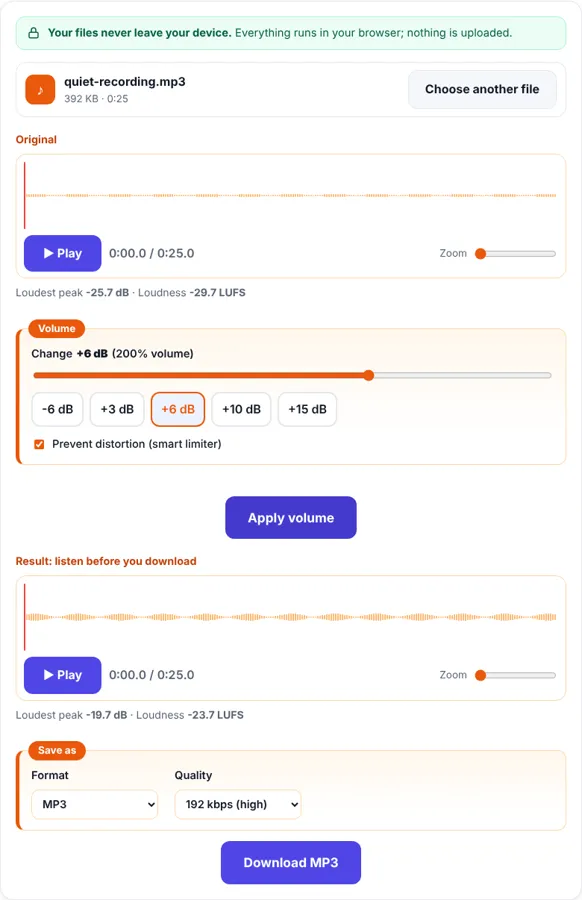

To increase the volume of an audio file, open **[Volume Booster](/volume-booster/)**, click **Choose audio file**, move the slider or tap **+6 dB** or **+10 dB**, keep **Prevent distortion** ticked, click **Apply volume**, listen to the result and click **Download MP3**. It is free, works on phone and computer, and your file is not uploaded.

> **Short answer:** Choose the file, tap +6 dB, click Apply volume, play the result, then download. If it is still too soft, try +10 dB.

## When you need to make audio louder

A quiet file is a common problem. Some everyday examples:

- A **class lecture or meeting** recorded from the back of the room.
- A **voice note or interview** where the person spoke softly or far from the phone.
- A **song or bhajan** downloaded at a low level that sounds weak on a speaker.
- An **audio track for a school function or reel** that is quieter than the other songs.

Turning up your phone volume helps only on your phone. Boosting the file itself makes it louder on every device you share it to.

## How to increase the volume of an audio file

1. Open **[Volume Booster](/volume-booster/)**.
2. Click **Choose audio file** and pick your file. You can also drop it on the box. MP3, WAV, M4A, AAC, OGG, FLAC and many other formats work.
3. The tool shows the waveform under **Original** with a **Play** button. Below it you see the **Loudest peak** in dB and the **Loudness** in LUFS.
4. Under **Volume**, move the **Change** slider, or tap a quick button: **+3 dB**, **+6 dB**, **+10 dB** or **+15 dB**. The label also shows the change as a percentage.
5. Keep **Prevent distortion (smart limiter)** ticked.
6. Click **Apply volume**.
7. Under **Result: listen before you download**, press **Play** and check that the sound is clear.
8. Under **Save as**, choose the **Format** (MP3, WAV or M4A) and the **Quality**.
9. Click **Download MP3** (the button name changes with the format). The file is saved with **-louder** added to its name.

Not happy with the result? Move the slider again and click **Apply volume** once more. Your original file is never changed.

## How much louder: picking the right dB

Sound level is measured in decibels (dB). The slider goes from **-20 dB** to **+20 dB**. Here is what the common settings mean:

| Setting | What it does | Good for |
|---|---|---|
| +3 dB | A small, gentle lift | Files that are only a little soft |
| +6 dB | Doubles the wave height, clearly louder | Most voice notes and songs |
| +10 dB | Sounds about twice as loud to most people | Lectures and far away voices |
| +15 dB to +20 dB | A very big boost | Very quiet recordings only |
| -6 dB | Makes the file quieter | Audio that is too loud or harsh |

Look at the **Loudest peak** number before you boost. 0 dB is the maximum a file can hold. If the peak is already close to 0 dB, a big boost will hit the limit, and the tool shows a message about clipping. With the limiter on, it gently turns down only those loud moments so the sound stays clean.

## Smart limiter on or off?

| Limiter | What happens with a big boost | Advice |
|---|---|---|
| On (ticked) | Loud moments are held just below the maximum, so there is no crackle | Keep it on almost always |
| Off | Parts that go over the maximum are cut flat, and you hear crackling or distortion | Turn off only if you know you need it |

Note that boosting makes everything louder, including background noise like fans, traffic or hiss. It cannot make a muffled voice clearer, only louder.

## Volume Booster or Audio Normalizer?

Both tools change loudness, but they work in different ways.

| Tool | You choose | Best for |
|---|---|---|
| [Volume Booster](/volume-booster/) | The exact amount, such as +6 dB | One file you want a bit louder or quieter |
| [Audio Normalizer](/audio-normalizer/) | A target level, such as Streaming (-14 LUFS) or Podcast (-16 LUFS) | Making several files sound equally loud |

If you plan to put many songs in one track, normalize them first and then follow our guide on [how to join audio files](/guides/how-to-join-audio-files/). If the sound you need is inside a video, take it out first with the steps in [how to extract audio from a video](/guides/how-to-extract-audio-from-video/).

## Which format and quality to save

| Format | Size | Use it for |
|---|---|---|
| MP3 | Small | WhatsApp, any phone, speaker or car stereo |
| M4A | Small | iPhone and Apple devices |
| WAV | Very large | Editing later in audio or video software |

For MP3 and M4A, the **Quality** list goes from 64 kbps to 320 kbps. **192 kbps (high)** is the default and suits music. For speech, **128 kbps (good)** keeps the file smaller. If the file is still too big to send, shrink it with **[Audio Compressor](/audio-compressor/)**. To keep only one part of the recording, trim it with **[MP3 Cutter](/mp3-cutter/)**.

## Boosting volume on a phone

Volume Booster works in Chrome on Android and Safari on iPhone. Tap **Choose audio file** and pick the file from your file manager or the **Files** app. On Android, recordings are often in the Recordings, Music or Download folder. Voice notes saved from chat apps may be in OPUS or OGG format, and the tool can open those too.

The work is done by your own device, so long files take more time. For files over 100 MB, the tool asks you to keep the tab open until it finishes, and a computer works best for very large files.
