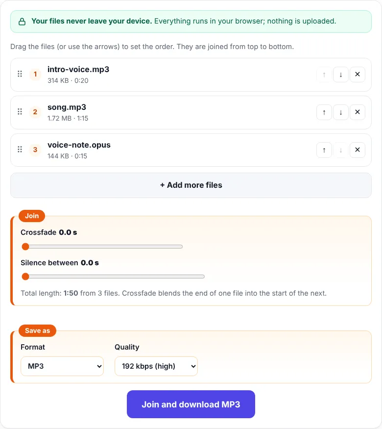

To join audio files, open **[Audio Joiner](/audio-joiner/)**, click **Choose audio files** and select two or more files, drag them into the right order, set a **Crossfade** or **Silence between** if you want, choose **MP3**, **WAV** or **M4A** and click **Join and download**. It is free, works on phone and computer, and your files are not uploaded.

> **Short answer:** Choose the files, put them in order from top to bottom, pick MP3 at 192 kbps and click Join and download.

## When joining audio files is useful

People join audio files for many everyday jobs:

- Putting together **songs for a school function, wedding sangeet or dance practice** in one track.
- Joining several **voice notes or recordings** of a lecture, meeting or interview.
- Adding an **intro and outro** to a podcast or YouTube voice over.
- Making one long **bhajan, aarti or study playlist** that plays without stopping.

## What files you can join

Audio Joiner reads most common audio formats, and you can mix them in one job.

| You have | Can you add it? |
|---|---|
| MP3 songs | Yes |
| M4A or AAC (iPhone recordings, many downloads) | Yes |
| WAV recordings | Yes |
| OGG or OPUS (voice notes are often saved like this) | Yes |
| FLAC music | Yes |
| WMA, AMR and other older formats | Usually, yes |

The files must be saved on your phone or computer. Songs that only play inside music streaming apps cannot be added. Use only audio you have the right to use.

## How to join audio files

1. Open **[Audio Joiner](/audio-joiner/)**.
2. Click **Choose audio files** and select two or more files. You can also drop them on the box.
3. Each file appears in a numbered list with its size and length. Files are joined **from top to bottom**.
4. Change the order by dragging a file by its handle, or use the **up** and **down** arrow buttons. Click the **cross** to remove a file.
5. Need another file? Click **Add more files**.
6. Under **Join**, set **Crossfade** (0 to 10 seconds) or **Silence between** (0 to 5 seconds). Leave both at 0 for a direct join.
7. Check the **Total length** shown under the sliders.
8. Under **Save as**, choose the **Format** (MP3, WAV or M4A) and the **Quality**.
9. Click **Join and download**. The file is saved with a name like joined-audio-3-files.mp3.
10. If you need it again, click **Download again**.

## Crossfade, silence or a direct join?

You can use a crossfade or silence, not both. When you set one, the other goes back to 0.

| Setting | What you hear | Best for |
|---|---|---|
| Both at 0 | The next file starts right after the last one ends | Parts of one recording, lecture pieces |
| Crossfade 2 to 5 seconds | The end of one song fades out while the next fades in, like a DJ mix | Song medleys, dance and party tracks |
| Silence 1 to 2 seconds | A short quiet pause between files | Voice notes, quiz audio, separate speeches |

Note that a crossfade overlaps the songs, so the joined track becomes a little shorter. Silence makes it a little longer. The **Total length** figure shows the result before you download.

## Which format and quality to choose

| Format | File size | Use it for |
|---|---|---|
| MP3 | Small | Sharing on WhatsApp, playing on any phone, speaker or car stereo |
| M4A | Small | iPhone and Apple devices, good sound at small size |
| WAV | Very large | Editing later in audio or video software |

For MP3 and M4A, the **Quality** list goes from 64 kbps to 320 kbps. **192 kbps (high)** is the default and is good for music. For speech only, such as lectures and voice notes, **128 kbps (good)** or lower keeps the file smaller. If the file is still too big to share, make it smaller with **[Audio Compressor](/audio-compressor/)**.

## Tips for a smooth joined track

| Problem | Fix |
|---|---|
| One song is much quieter than the others | Run the files through [Audio Normalizer](/audio-normalizer/) first so they sound even |
| The whole track is too soft | Make it louder with [Volume Booster](/volume-booster/) |
| A file has a long silent start or end | Trim it first with [MP3 Cutter](/mp3-cutter/) |
| You only need the sound from a video | Take it out with [Video to MP3](/video-to-mp3/) first |
| A file shows an error in the list | That file may be damaged. Convert it with [Audio Converter](/audio-converter/) and add it again |

Our guide on [how to extract audio from a video](/guides/how-to-extract-audio-from-video/) shows how to get songs and speech out of video clips. To make a short ringtone from the joined track, see [how to make a ringtone from a song](/guides/how-to-make-ringtone-from-song/).

## Joining on a phone

Audio Joiner works in Chrome on Android and Safari on iPhone. Tap **Choose audio files** and pick the files from your **Files** app or file manager. On Android, songs and recordings are often in the Music, Recordings or Download folders. On iPhone, the joined file is saved in the **Files** app, usually in Downloads.

Joining is done by your device, so very long or very large files take more time and memory. For files of more than 100 MB, the tool shows a message asking you to keep the tab open, and a computer works best for very large files.
