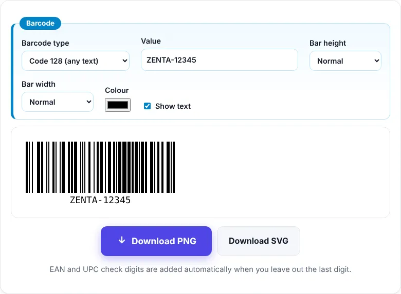

To make a barcode for a product, open **[Barcode Generator](/barcode-generator/)**, choose the **Barcode type**, type your number or code in the **Value** box and click **Download PNG** or **Download SVG**. Use **Code 128** for your own stock and shop labels, and **EAN-13** for packed products sold in retail. It is free and needs no sign up.

> **Short answer:** Code 128 for your own items, EAN-13 for retail products. For EAN-13 numbers that shops and marketplaces will accept, register with GS1 India first.

## Which barcode type should you use?

ZentaPDF Barcode Generator can make six types. Each one is meant for a different job.

| Barcode type | What it holds | Best for |
|---|---|---|
| Code 128 | Letters, numbers and symbols | Your own stock, shop labels, files, courier and shipping labels |
| EAN-13 | 13 digits | Retail products sold in shops and online in India and most countries |
| EAN-8 | 8 digits | Very small packs where an EAN-13 does not fit |
| UPC-A | 12 digits | Products sold in the USA and Canada |
| Code 39 | Capital letters, numbers and a few symbols | Older systems that already use Code 39 |
| ITF-14 | 14 digits | Outer cartons and cases, not single items |

If the barcode is only for your own shop, godown or office, use Code 128 and decide the codes yourself. If other shops or marketplaces will sell the product, use EAN-13 with a number from GS1 India.

## Do you need GS1 India numbers?

A barcode is just a picture of a number. Anyone can draw the picture, but the **number** matters when other businesses scan it. **GS1 India** says that products made in India carry barcodes beginning with **890**, and that it is the only organisation in India authorised to issue barcodes starting with 890. Its EAN-13 numbers have three parts:

1. A **company prefix**, which includes the 890 country code and your company code.
2. A **product code** that you give to each product.
3. A **check digit** at the end, worked out from the other 12 digits.

GS1 India also says that retailers, marketplaces and supply chain partners recommend GS1 barcodes, and that marketplaces generally ask for the **GTIN** (the barcode number) of a product. To get numbers, you fill in the registration form on the GS1 India website, give the documents it asks for and pay the fee. Fees, documents and rules can change, so check the official GS1 India website before you apply.

Once you have your numbers, you can use ZentaPDF to make the barcode images for each product.

**Note:** the 890 prefix shows which GS1 office gave out the number. It does not prove where a product was made.

## How to make a barcode

1. Open **[Barcode Generator](/barcode-generator/)**.
2. Under **Barcode type**, choose the type, for example **Code 128 (any text)** or **EAN-13 (retail products)**. A sample value appears so you can see the preview straight away.
3. In the **Value** box, type your own code or number. The preview changes as you type.
4. Set **Bar height** to Short, Normal or Tall, and **Bar width** to Thin, Normal or Wide.
5. Keep **Show text** ticked if you want the number printed under the bars. Most product labels show it, so a person can type it if the scan fails.
6. Leave **Colour** as black unless you have a good reason to change it.
7. Click **Download PNG** for Word files, labels and printing at home, or **Download SVG** for a designer or a printing press.

If the value does not fit the type, you see a red message instead of the barcode. For example, EAN-13 accepts only digits. Type **12 digits** and the tool adds the 13th check digit for you. Type **13 digits** and the last one must be the correct check digit.

## PNG or SVG: which file to download

| Download | What it is | Use it when |
|---|---|---|
| PNG | A normal image at 3 times the preview size | Adding to Word, Excel, label software or printing on an office printer |
| SVG | A vector file that stays sharp at any size | Sending to a designer, a box printer or a sticker printing shop |

Both files have a white background and a white margin around the bars. Do not crop that margin away, because scanners need some blank space on both sides of the bars.

## Tips for barcodes that scan every time

| Do | Why |
|---|---|
| Print dark bars on a white or very light background | Scanners read the contrast between bars and spaces |
| Keep the white margin on the left and right | Scanners use it to find where the barcode starts and ends |
| Do not stretch the image in one direction only | Changing the width of the bars can make it unreadable |
| Print a test label first | Scan it with a barcode scanner or a phone scanning app before you print hundreds |
| Avoid red bars | Many scanners use red light, so red bars can look like blank space |
| Use one number for one product | Each size, colour or pack size should have its own code |

To put many barcodes on one sheet, download them as PNG files and place them in a Word or Excel label template. You can also join the images into one printable file with **[Images to PDF](/images-to-pdf/)**. If a PNG is too large for your label, change its size with **[Resize Image](/resize-image/)** and keep the width and height in proportion.

## Barcode or QR code?

A barcode holds a short number or code, and it is what billing counters and stock systems expect. A **QR code** can hold much more, such as a website link, your UPI ID, Wi-Fi details or a Google Form. If you want customers to open a link from the packet, add a QR code from **[QR Code Generator](/qr-code-generator/)** next to the barcode. Our guide on [making a QR code for a Google Form or Wi-Fi](/guides/how-to-make-qr-code-for-google-form-or-wifi/) shows how.

## If the barcode does not scan

Check that the bars are not stretched or printed too small. Download again with **Bar width** set to Normal or Wide and print at full size. If a marketplace rejects your number, use a number given to you by GS1 India and check the marketplace's own seller help pages for its rules.
