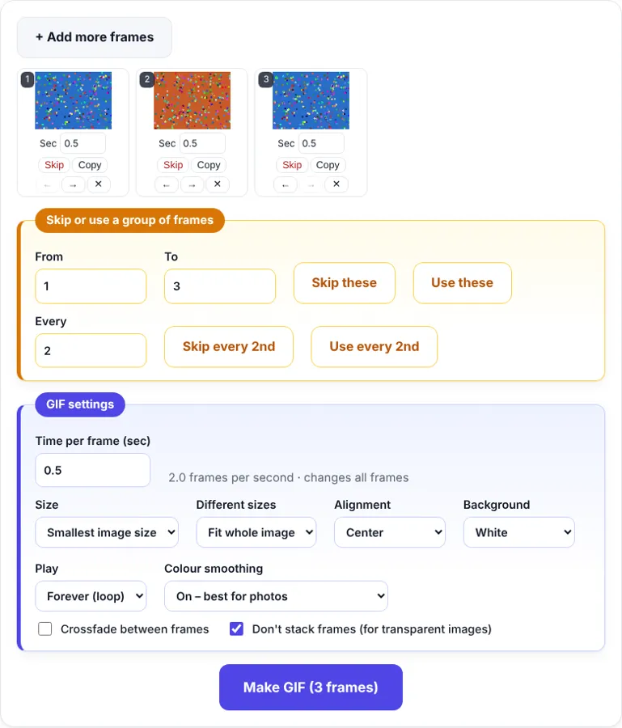

A GIF made from photos shows the pictures one after another in a loop, like a small slideshow that plays by itself. People make them for a before and after photo, a product shown from different sides, a birthday greeting, or steps of a recipe. You can make one in your browser on a phone or computer, with no app and no watermark.

> **Short answer:** open [GIF Maker](/gif-maker/), click **Choose images** and select your photos. Put them in order with the arrows, set **Time per frame** under **GIF settings**, click **Make GIF** and then **Download GIF**.

## How to make a GIF from photos

1. Open **[GIF Maker](/gif-maker/)**.
2. Click **Choose images** or drop your photos into the box. JPG, PNG, WebP and iPhone HEIC photos work, and you can add GIFs too. You can use up to 150 frames.
3. Your photos appear as numbered frames. Use the **←** and **→** buttons under a frame to move it, and **✕** to remove it. Click **Add more frames** to add more photos.
4. Under **GIF settings**, set **Time per frame (sec)**. It starts at 0.5 seconds and changes all frames at once.
5. To give one photo more time, type the seconds in the **Sec** box under that frame.
6. Choose the **Size**, and how many times the GIF should **Play**.
7. Click **Make GIF**. The button shows how many frames will be used. You need at least 2.
8. Check the preview. It shows the size in pixels, the number of frames, the total time and the file size.
9. Click **Download GIF**. The file is saved as animation.gif. Click **Change settings** if you want to try again.

## GIF settings explained

| Setting | Choices | What it does |
|---|---|---|
| Time per frame (sec) | Any value from 0.02 | How long each photo stays on screen. The tool shows the frames per second next to it |
| Size | Smallest image size, or 240 to 1080 px wide | The width of the GIF. The height follows the shape of the smallest photo |
| Different sizes | Fit whole image, Fill and crop, Stretch | How photos of other sizes are fitted into the frame |
| Alignment | Center, Top, Bottom, Left, Right and the four corners | Which part of the photo stays in view when it is fitted or cropped |
| Background | White, Black, Transparent | The colour around photos that do not fill the frame |
| Play | Forever (loop), Once, 2, 3, 5 or 10 times | How many times the GIF plays before it stops |
| Colour smoothing | On for photos, Off for graphics | On gives smoother colours. Off gives a smaller file for simple graphics |

With **Smallest image size**, the GIF is also kept to 800 pixels on its longest side.

## Crossfade, Skip and Copy

- **Crossfade between frames** adds soft blended frames between your photos, so one picture fades into the next instead of jumping. It adds 4 extra frames of 0.05 seconds each between every pair of photos, so the GIF gets longer and the file gets bigger.
- **Skip** under a frame leaves that photo out without deleting it. Click **Use** to bring it back.
- **Copy** makes a second copy of the frame right after it. Use it to hold the first or last photo a little longer.
- In **Skip or use a group of frames**, type **From** and **To** numbers and click **Skip these** or **Use these**. **Every** with **Skip every 2nd** removes every second frame, which is useful when you added the frames of a long GIF.

## Making the GIF smaller

GIF files grow quickly with more photos and bigger sizes. If yours is too big to send, try these one at a time.

| Change | Effect |
|---|---|
| Pick 480 or 320 px under Size | Fewer pixels in every frame |
| Use fewer photos | Fewer frames to store |
| Turn off Crossfade | No extra blended frames |
| Set Colour smoothing to Off | Smaller file, best for graphics and text |
| Run it through [Compress GIF](/compress-gif/) | Squeezes the finished GIF further |

The [compress GIF guide](/guides/how-to-compress-gif/) explains each option in Compress GIF. To change the size of a GIF you already made, use [Resize GIF](/resize-gif/).

## Sharing your GIF

Most chat apps, social media sites and websites accept GIF files, but some apps play them as short videos or do not play them at all. If an app does not show your GIF moving, convert it to a small MP4 with [GIF to MP4](/gif-to-mp4/). The [GIF to MP4 guide](/guides/how-to-convert-gif-to-mp4/) shows the steps.

## Make a GIF from a video instead

If your moment is in a phone video, you do not need to take screenshots. Use [Video to GIF](/video-to-gif/), which turns a part of the video into a GIF directly. The [video to GIF guide](/guides/how-to-convert-video-to-gif/) explains how to choose the start, length and size.

## Tips for a good GIF

- Use photos taken from the same spot and in the same shape. They line up better and need no cropping.
- For a before and after GIF, use 2 photos with 1 to 2 seconds each.
- Keep important things near the centre if your photos are different shapes, or pick an Alignment that keeps them in view.
- For a transparent background, use PNG images and choose Transparent under Background. Leave **Don't stack frames** ticked so old frames do not show through.
