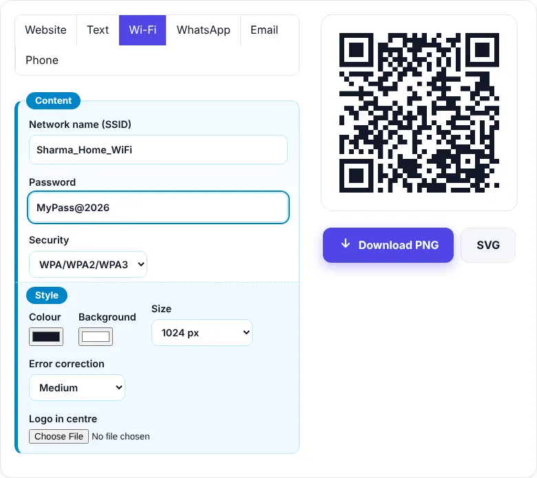

To make a QR code for a Google Form, copy the form's responder link, paste it into the **Website** tab of **[QR Code Generator](/qr-code-generator/)** and click **Download PNG**. For Wi-Fi, choose the **Wi-Fi** tab, type the network name and password, and download. Both are free, need no sign up and never expire.

## Google Form or Wi-Fi: what you need

| QR code for | Tab to choose | What you type | What happens when someone scans |
|---|---|---|---|
| Google Form | Website | The form's responder link | The form opens in their browser |
| Wi-Fi | Wi-Fi | Network name, password, security type | The phone offers to join the network |

## Step 1 for a Google Form: copy the right link

The QR code must hold the link that people use to fill the form, not the edit link you see in your browser while making it.

1. Open your form in Google Forms.
2. Make sure it is published. If you see a **Publish** button at the top right, click it and finish publishing. Google's help says responders cannot open an unpublished form.
3. Click **Published** (or **Share**) at the top right and then **Copy responder link**.
4. If you see a **Shorten URL** box, tick it to get a short forms.gle link. A shorter link makes a simpler QR code that is easier to scan.

Who can fill the form depends on your form settings. If people in your class or event do not have your school or office account, check the access settings in Google Forms before you print anything.

## Step 2: make the Google Form QR code

1. Open **[QR Code Generator](/qr-code-generator/)**.
2. Keep the **Website** tab selected.
3. Delete the sample address and paste your form link in **Website address**.
4. The preview on the right updates at once.
5. Optional: change **Colour**, **Background** or **Size**, or add a **Logo in centre**.
6. Click **Download PNG**. For posters and banners, click **SVG** instead.
7. Scan the downloaded code with your own phone and make sure the right form opens.

## How to make a Wi-Fi QR code

1. Open **[QR Code Generator](/qr-code-generator/)** and click the **Wi-Fi** tab.
2. Type the **Network name (SSID)** exactly as it shows on your phone. Capital and small letters must match.
3. Type the Wi-Fi **Password**.
4. Choose **Security**: **WPA/WPA2/WPA3** for almost all home and office routers, **WEP** only for very old routers, or **None** for an open network.
5. Click **Download PNG** and test it with a phone that is not yet connected.

Special characters in the network name or password, such as ; or : or a comma, are handled for you. This tool has no setting for hidden networks, so a hidden network may not join from the code.

## How people scan the code

| Phone | How to scan |
|---|---|
| iPhone | Open the Camera app, point it at the code and tap the message that appears (for Wi-Fi, tap **Join**) |
| Android | Open the Camera app or Google Lens and point it at the code, then tap the link or the join option |
| Phone without a scanner | Install a trusted QR scanner app from the app store |

The exact buttons depend on the phone brand and software version.

Tip: on many Android phones (Android 10 and later) you can also show a QR code for the network you are connected to from the Wi-Fi settings, by tapping the network and then the QR icon. That is handy for one guest, while a printed code is better for a shop, office or classroom.

## Size, colour and print tips

| Setting | Best choice |
|---|---|
| Size | 1024 px for screens and WhatsApp, 2048 px (print) for printing |
| File type | PNG for screens, documents and WhatsApp; SVG for large prints |
| Colour | Dark code on a light background. Avoid light colours on white |
| Error correction | Medium is fine for most uses. Choose High or Highest if the code may get dirty or folded |
| Logo | Keep it simple. The highest error correction is used by itself |

More tips:

- **Leave white space around the code.** Do not let text or pictures touch its edges.
- **Test after printing.** Scan the printed sheet from the distance people will stand at.
- **Add a line of text** like "Scan to fill the feedback form" or "Scan to join Wi-Fi" so people know what it does.
- **Need it in a PDF?** Put the PNG into a document with **[JPG to PDF](/jpg-to-pdf/)**, which also accepts PNG images.
- **A site wants a JPG or a small file?** Convert it with **[PNG to JPG](/png-to-jpg/)** (see [how to convert PNG to JPG](/guides/how-to-convert-png-to-jpg/)) or shrink it with **[Reduce Image Size in KB](/reduce-image-size-in-kb/)**. See also [how to reduce image size in KB](/guides/how-to-reduce-image-size-in-kb/).

## Static QR codes: what that means for you

The codes from ZentaPDF are **static**. The link or Wi-Fi details are stored inside the code itself, so:

- They never expire and do not depend on our website.
- There is no scan count or tracking.
- To change the link or the password, you make a new code and print it again.

For a Google Form, the link stays the same even when you edit the questions, so your printed code keeps working. If you close the form to new responses, people who scan it will see that it is closed.

## Other QR codes you can make

The same tool also has **Text**, **WhatsApp**, **Email** and **Phone** tabs. For product labels with a barcode instead of a QR code, use **[Barcode Generator](/barcode-generator/)**.
