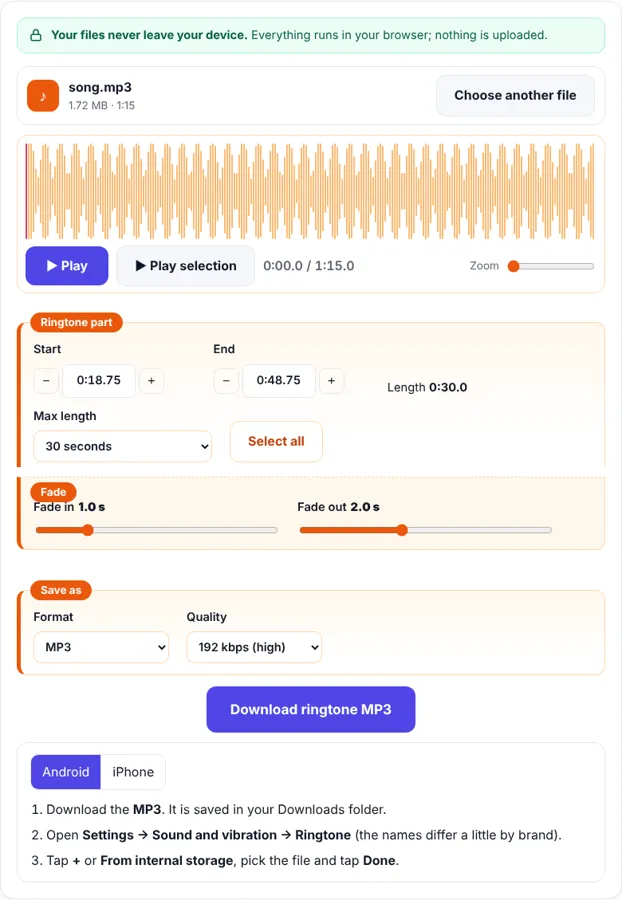

To make a ringtone from a song, open **[Ringtone Maker](/ringtone-maker/)**, choose the song, move the highlighted part on the waveform to the lines you like, set the **Fade in** and **Fade out**, pick **MP3** for Android or **M4R** for iPhone, and click **Download ringtone**. Then set the file as your ringtone in your phone settings. It is free and needs no app or sign up.

> **Short answer:** Choose the song, keep the best 30 seconds or less, add a fade and download. MP3 works on Android, and on iPhone with recent iOS.

## What you need

- A song or audio file that is **saved on your phone or computer**, such as MP3, M4A, WAV, AAC or FLAC. Songs streamed inside music apps cannot be used.
- A browser such as Chrome or Safari.

Use songs you have the right to use. Many people make ringtones from their own recordings, devotional songs or tracks they have bought.

## How to make the ringtone

1. Open **[Ringtone Maker](/ringtone-maker/)**.
2. Click **Choose audio file** and pick your song.
3. The waveform appears. The tool already marks 30 seconds from about a quarter of the way into the song.
4. Click **Play** to listen. Drag the highlighted part on the waveform to the lines you want, for example the start of the chorus.
5. Fine tune the **Start** and **End** times. The **minus** and **plus** buttons move them by 0.1 second.
6. Check **Length**. Use **Max length** to choose 30 seconds or 40 seconds.
7. Click **Play selection** to hear only your ringtone part.
8. Set **Fade in** and **Fade out** (0 to 5 seconds). They start at 1 and 2 seconds, so the ringtone starts and ends softly.
9. Under **Save as**, choose **MP3** or **M4R (iPhone)** and the **Quality**. 192 kbps is the default and sounds good.
10. Click **Download ringtone**. If you need the file again, click **Download again**.

## MP3 or M4R: which one to choose

| Your phone | Format to download | Length |
|---|---|---|
| Android (Samsung, Xiaomi, Vivo, Oppo, Realme, Motorola and others) | MP3 | 30 seconds is plenty |
| iPhone with iOS 26 or newer, set from the Files app | MP3 | Under 30 seconds, so keep it at 29 seconds |
| iPhone set from a computer (Finder, Apple Devices or iTunes) | M4R (iPhone) | Up to 40 seconds |

A phone call rarely rings longer than 30 seconds, so a longer clip is not needed. For a **notification or alarm sound**, make a short clip of 3 to 5 seconds.

## Set the ringtone on Android

The exact menu names change a little from brand to brand. On a **Samsung Galaxy**, Samsung's own help pages give these steps:

1. Make sure the MP3 is saved on the phone. It is usually in the **Downloads** folder.
2. Open **Settings** and go to **Sounds and vibration**, then tap **Ringtone**.
3. If you have two SIMs, choose the SIM.
4. Tap the **+** icon.
5. Pick your file. If it is not under Tracks, look in **Folders**, or use **Search**.
6. Tap **Done**.

On other Android phones, open **Settings**, type **ringtone** in the search bar, and look for a **+** button or an option such as **From internal storage**.

**Ringtone for one contact on Samsung:** open the **Phone** app, tap the contact, tap the **Info** icon and then **Edit**. Tap **View more**, then **Ringtone**, tap **+** to pick the song, tap **Done**, go back and tap **Save**.

## Set the ringtone on iPhone

**Method 1: iOS 26 or newer, no computer needed**

1. Make the ringtone as **MP3** and keep it **under 30 seconds** (29 seconds is safe).
2. Make sure the file is in the **Files** app, for example in Downloads.
3. Press and hold the file, tap **Share**, then tap **Use as Ringtone**.
4. The iPhone opens the ringtone list with your new tone selected.

If you do not see **Use as Ringtone**, update your iPhone and check that the file is MP3 or M4A and shorter than 30 seconds.

**Method 2: with a computer, for older iOS**

1. Download the **M4R** file (40 seconds or less) on your computer.
2. Connect the iPhone. On a Mac open **Finder**. On Windows open **Apple Devices** or **iTunes**.
3. Drag the M4R file onto the iPhone (in iTunes, onto **Tones**).
4. On the iPhone, go to **Settings**, **Sounds and Haptics**, **Ringtone** and choose it.

Apple can change these menus in new iOS versions, so check Apple's support pages if a step looks different.

## Tips for a good ringtone

| Tip | Why it helps |
|---|---|
| Start at the hook or chorus | You know the song from the first second |
| Keep a 1 to 2 second fade in | The ring does not start with a sudden loud blast |
| Avoid long quiet intros | A silent start can make you miss calls |
| Is the song too soft? | Make it louder first with [Volume Booster](/volume-booster/) |
| Song is in a format your phone does not accept | Change it with [Audio Converter](/audio-converter/) |

## Make a ringtone from a video

Liked a tune in a video you recorded or saved? Ringtone Maker can open the sound of many video files. You can also take out the full audio first with **[Video to MP3](/video-to-mp3/)**. Our guide on [how to extract audio from a video](/guides/how-to-extract-audio-from-video/) shows the steps.

If you only want to cut a song or voice note without the ringtone limits, use **[MP3 Cutter](/mp3-cutter/)**, which can keep or remove any part and save as MP3, WAV or M4A.
