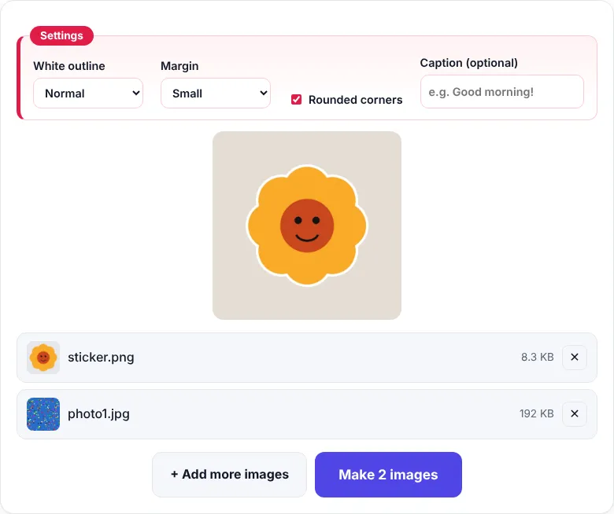

To make WhatsApp stickers from your photos, open **[WhatsApp Sticker Maker](/whatsapp-sticker-maker/)**, choose one or more photos, pick an outline, margin and optional caption, then click **Make** and download the stickers. Each sticker comes out as a 512 x 512 WebP image, the format WhatsApp uses. Then add it in WhatsApp with the **Create sticker** option.

> **Short answer:** Photo in, ready sticker out. Free, no app to install and no sign up.

## What a WhatsApp sticker needs

WhatsApp publishes its sticker rules for app makers on its official GitHub page. These are the main points:

| Rule | What WhatsApp asks for |
|---|---|
| File format | WebP |
| Size in pixels | Exactly 512 x 512 |
| Background | Transparent |
| File size (still sticker) | 100 KB or less |
| File size (animated sticker) | 500 KB or less |
| Outline | A white 8 px outline is recommended, not required |
| Stickers in one pack (sticker apps) | 3 to 30 |
| Pack icon (sticker apps) | 96 x 96 pixels, 50 KB or less |

A normal phone photo is a JPG of several MB and is not square, so it needs to be resized, placed on a square and saved as a light WebP file. That is the work the sticker maker does for you.

## How to make stickers from photos

1. Open **[WhatsApp Sticker Maker](/whatsapp-sticker-maker/)** in Chrome or Edge, on your phone or computer.
2. Click **Choose images** and pick your photos. You can add up to 30 at a time.
3. Choose a **White outline**: None, Thin, Normal or Thick.
4. Choose a **Margin**: None, Small or Large. A margin leaves clear space around the picture.
5. Tick or untick **Rounded corners**.
6. Type a **Caption** if you want one, for example "Good morning!". It can be up to 30 characters, and you can pick the caption colour.
7. Look at the preview. It shows the sticker on a WhatsApp style background.
8. Click **Make**, then **Download image** for one sticker or **Download all (ZIP)** for many.

The tool fits your photo inside the square without cutting it, adds the outline and caption, and saves it as WebP. If the file is bigger than 100 KB, it lowers the quality step by step until it fits.

**Tip:** If the browser cannot create WebP files, the tool shows a message and saves PNG instead. Chrome on Android and on computers creates WebP. Some browsers, for example on iPhone, may not, but a PNG sticker still works with WhatsApp's Create sticker option.

## Which settings to use

| You want | Try this |
|---|---|
| A classic sticker look | Normal outline, Small margin, Rounded corners on |
| A cut out person or object | A transparent PNG, Normal or Thick outline |
| A greeting sticker | Add a short caption such as "Happy Diwali" |
| A full square photo | No outline, No margin, Rounded corners on |
| Many stickers for a pack | Add all photos at once and download the ZIP |

The outline follows the shape of your picture. On a normal rectangular photo it draws a white frame. On a PNG with a transparent background it goes around the person or object, which gives the typical sticker look.

## How to add the stickers to WhatsApp

WhatsApp keeps changing where its buttons are, so the names on your phone may be a little different. Update WhatsApp first.

**On WhatsApp Web or the desktop app**

1. Open a chat and click the emoji or sticker button next to the message box.
2. Open the **Stickers** tab and choose **Create** (the + button).
3. Pick the sticker file you downloaded and click **Send**.

**On iPhone and Android**

1. Save the sticker to your phone's gallery or files.
2. Open a chat, tap the sticker icon in the message box and tap the **+** (Create sticker) button.
3. Choose the sticker image and send it. WhatsApp keeps it in your sticker tray for next time.

Inside WhatsApp's own sticker maker you can also cut out the main subject, add text or draw. If you already made the sticker on ZentaPDF, just send it as it is.

On Android you can also use a sticker pack app from the Play Store that imports WebP files into a pack. Remember that a pack made this way needs at least 3 stickers.

## Getting the best stickers

- **Crop first.** Cut away extra background with [Crop Image](/crop-image/) so the face or object fills the sticker.
- **iPhone photos.** HEIC photos work in the sticker maker. If another app cannot open them, change them with [HEIC to JPG](/guides/how-to-convert-heic-to-jpg/).
- **Keep captions short.** Long text becomes small. Two or three words read best on a phone.
- **Use bright, simple pictures.** Stickers are shown small, so clear shapes and strong colours work best.
- **Ask before you share.** Make stickers of other people only with their permission.

## Common problems and fixes

| Problem | Fix |
|---|---|
| WhatsApp shows the sticker as a normal photo | Send it from the sticker tray with Create sticker, not as a photo attachment |
| A white box around the picture | Your photo has a white background. Start with a transparent PNG |
| The caption is too small | Use a shorter caption, the text size drops to fit long words |
| Saved as PNG, not WebP | Open the page in Chrome or Edge on Android or a computer and make the sticker again |
| The sticker should move | This tool makes still stickers only. For a moving picture to send in chats, see [how to resize an animated GIF](/guides/how-to-resize-animated-gif/) |
