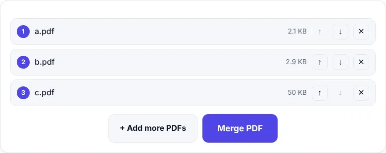

Sending one tidy PDF is much better than five separate attachments, for job applications, visa documents, invoices or project reports. Here's how to merge PDF files on any device, free.

## The quickest way (any device)

2. Click **Choose PDF files** and select all the PDFs (hold **Ctrl** on Windows or **Cmd** on Mac to pick several). You can also drag them in.
3. Put them in the right order with the **↑ ↓** arrows. Click **✕** to remove one.
4. Click **Merge PDF**.
5. Click **Download PDF**.

## On Windows

Windows has no built-in "merge PDF" button, so most people install heavy software just for this. You don't need to:

1. Open **Edge** or **Chrome**.
2. Go to [zentapdf.com/merge-pdf/](/merge-pdf/).
3. Drag PDFs from File Explorer into the box and follow the steps above.

## On Mac

macOS can merge PDFs in **Preview** (open one PDF, show thumbnails, and drag other PDFs into the sidebar). It works, but ordering many files is fiddly. A browser tool is often faster: open [Merge PDF](/merge-pdf/) in Safari or Chrome and drag the files in from Finder.

## On Android

1. Open Chrome and go to [zentapdf.com/merge-pdf/](/merge-pdf/).
2. Tap **Choose PDF files** and select the files from **Downloads** or **Files**.
3. Arrange, merge and download. The merged PDF appears in your Downloads folder.

## On iPhone and iPad

1. Open Safari and go to [zentapdf.com/merge-pdf/](/merge-pdf/).
2. Tap **Choose PDF files** → **Browse** and pick files from the Files app.
3. Merge and download. Tap the download icon to open the PDF, then **Share** to send it or save it to Files.

## Getting the order right

- **Rename files first** with numbers, for example `1-cover.pdf`, `2-resume.pdf`, `3-certificates.pdf`. They'll appear in that order when you select them.
- Need to move **individual pages**, not whole files? Merge first, then use [Reorder Pages](/reorder-pdf-pages/) to drag pages around.
- Got an extra blank page? Delete it with [Remove Pages](/remove-pages/).

## Merged file too big?

Merging adds the sizes together. If the result is too large to email or upload, run it through [Compress PDF](/compress-pdf/), PDFs with scans or photos often shrink by 50 to 90%.

## Merging photos and PDFs

Got photos of certificates as JPGs? Convert them first with [JPG to PDF](/jpg-to-pdf/), then merge that PDF with the rest.

## Merging scanned documents

If you scanned pages one by one with your phone, you might have many small PDFs or images. The easiest flow is:

1. Turn photos into a PDF with [Images to PDF](/images-to-pdf/) (or [JPG to PDF](/jpg-to-pdf/)).
2. Merge it with any other PDFs in [Merge PDF](/merge-pdf/).
3. Fix any sideways pages with [Rotate PDF](/rotate-pdf/).
4. Make the final file smaller with [Compress PDF](/compress-pdf/).

## Tips for job and visa applications

- **Follow the order the form asks for**, for example application form, ID, education certificates, experience letters.
- **Put a cover or index page first** if you're sending many documents.
- **Check the size limit** before uploading; many portals accept only 1 to 2 MB.
- **Name the file clearly**, like `Priya-Sharma-Application.pdf`.

## Does merging reduce quality?

No. Merge PDF copies each page exactly as it is, text stays selectable, images keep their quality and links keep working. Only bookmarks (the outline panel) from the original files are not carried over.

## Common problems

| Problem | Solution |
|---|---|
| "This PDF is password-protected" | Unlock it first with [Unlock PDF](/unlock-pdf/) using the password you know |
| Pages are sideways | Fix them with [Rotate PDF](/rotate-pdf/) |
| Phone is slow with huge files | Merge on a computer, or compress the files first |

Merging PDFs should take seconds, not software installs. Now it does.
