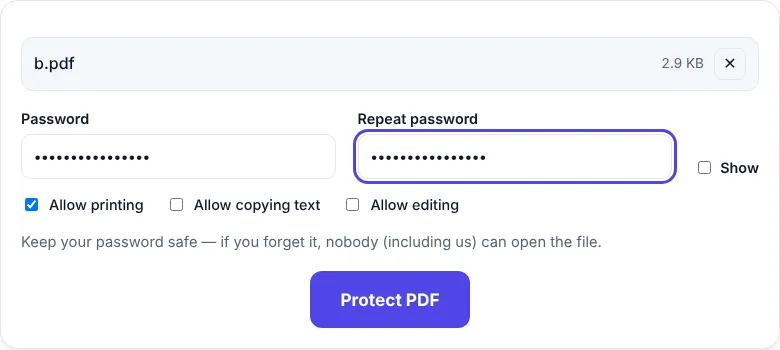

Bank statements, salary slips, ID documents, contracts and medical reports should not be readable by anyone who happens to get the file. A password on the PDF is the simplest protection, and it takes less than a minute.

## How PDF passwords work

A PDF can have two kinds of password:

| Password | What it does |
|---|---|
| **Open password** (user password) | Needed to open and read the file. This is real protection. |
| **Permissions** (owner password) | Limits printing, copying or editing once the file is open. |

ZentaPDF sets an **open password** using **AES-256 encryption**, the strongest encryption in the PDF standard, and lets you choose whether printing, copying text and editing are allowed.

## How to password protect a PDF

1. Open **[Protect PDF](/protect-pdf/)**.
2. Choose your PDF.
3. Type a **password** and type it again to confirm. Tick **Show** to check for typos.
4. Choose what is allowed: **printing**, **copying text**, **editing**.
5. Click **Protect PDF**, then **Download PDF**.

Now open the downloaded file, your PDF reader will ask for the password.

## Choosing a good password

- Use **at least 8 to 12 characters**, mixing words and numbers, e.g. `Mango-River-2026`.
- Don't use only your name, date of birth or phone number, they're easy to guess.
- **Send the password separately** from the file. If you email the PDF, share the password by phone call or SMS, not in the same email.
- Store it in a password manager. **If you forget it, nobody can open the file**, not even us.

## Other ways to protect a PDF

- **Microsoft Word:** *File → Save As → PDF → Options → Encrypt the document with a password*. Useful when you create the PDF yourself.
- **Paid PDF software** like Adobe Acrobat Pro can also add passwords.

ZentaPDF is handy when you already have a PDF and don't want to install anything.

## Removing a password later

If you know the password and want an unlocked copy (so you don't have to type it each time), use [Unlock PDF](/unlock-pdf/).

## Extra protection ideas

- Add a **"CONFIDENTIAL"** watermark with [Add Watermark](/add-watermark/), so printed copies are clearly marked.
- For filled forms, use [Flatten PDF](/flatten-pdf/) first, so answers can't be changed.

## Which documents should you protect?

| Document | Why |
|---|---|
| Bank statements, salary slips, ITR | Contain income and account details |
| Aadhaar, PAN, passport scans | Can be misused for identity fraud |
| Contracts and offer letters | Confidential terms and signatures |
| Medical reports | Very personal health information |
| Business proposals and price lists | Valuable to competitors |

Many banks and employers already send statements as password-protected PDFs, usually with a password based on your name and date of birth. You can do the same for documents you send.

## Restrict printing and copying

The permission options are useful when you share a document but want to limit what people do with it:

- **Untick "Allow copying text"** so text can't be easily copied into another document.
- **Untick "Allow printing"** for documents meant to be read on screen only.
- **Untick "Allow editing"** so annotations and changes are blocked in standard PDF readers.

Keep in mind that permissions are respected by normal PDF readers but are not as strong as the open password. For real secrecy, rely on a good open password.

## Sharing the password safely

1. Email or upload the protected PDF.
2. Send the password **through a different channel**, a phone call, SMS or a messaging app.
3. For recurring documents, agree on a password pattern with the receiver in advance.

## Troubleshooting

| Problem | Solution |
|---|---|
| "This PDF is already password-protected" | Unlock it first with [Unlock PDF](/unlock-pdf/), then add your new password |
| Receiver can't open the file | Check for typos and capital letters in the password; make sure their PDF reader is up to date |
| Need to edit the PDF later | Keep an unprotected copy, or unlock it with the password when you need to |

