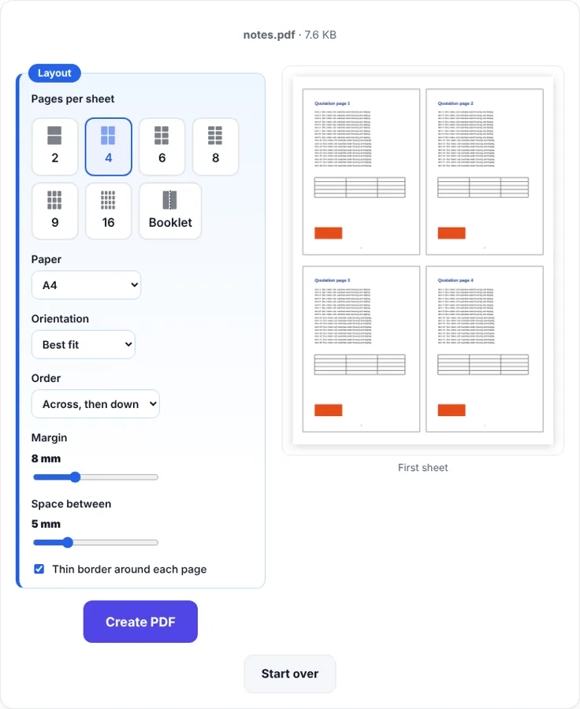

To print multiple pages on one sheet, open **[Pages per Sheet](/pages-per-sheet/)**, choose your PDF, pick **2, 4, 6, 8, 9 or 16** pages per sheet, and click **Create PDF**. You get a new PDF where every sheet already has several pages on it, so it prints the same way on any printer, at home or at a print shop.

This saves a lot of paper for class notes, PPT handouts and long reports.

## How many pages per sheet should you choose?

| Pages per sheet | Sheets for a 40 page PDF (one side) | Best for |
|---|---|---|
| 1 (normal) | 40 | Forms, letters, anything you will sign or submit |
| 2 | 20 | Reports and notes that you still want to read comfortably |
| 4 | 10 | PPT slides, revision notes, drafts for checking |
| 6 or 8 | 7 or 5 | Slide handouts with large text |
| 9 or 16 | 5 or 3 | Very large text only, like slide thumbnails |
| Booklet | 10 (printed on both sides) | Small books, event programmes, manuals |

Printing on both sides halves the sheet count again. A 40 page PDF at 4 pages per sheet, printed on both sides, needs only 5 sheets.

Do not use this for official forms, applications or certificates. Those must be printed one page per sheet at full size.

## How to print multiple PDF pages on one sheet (step by step)

1. Open **[Pages per Sheet](/pages-per-sheet/)**.
2. Click **Choose PDF file**, or drag and drop the PDF into the box.
3. Under **Pages per sheet**, click **2, 4, 6, 8, 9 or 16**. The preview on the right shows the first sheet.
4. Pick the **Paper** size. A4 is selected by default, which is the normal paper size in India. You can also choose Letter, A3, Legal, A5 or Same as pages.
5. Leave **Orientation** on **Best fit**. It tries portrait and landscape and picks the one where the pages are largest.
6. If you like, change **Order** (Across, then down or Down, then across), the **Margin**, the **Space between** pages, and the **Thin border around each page**.
7. Click **Create PDF** and then **Download PDF**.
8. Open the new PDF and print it. In the print window, keep the scale at 100% or "Actual size" so the layout is not shrunk again.

The pages are placed as sharp vector content, not as pictures, so text stays clear even when it is small.

## Settings explained

| Setting | What it does | Tip |
|---|---|---|
| Paper | The size of the sheet you will print on | Use A4 unless your printer has other paper |
| Orientation | Portrait or landscape sheet | Best fit chooses for you |
| Order | The direction pages follow on the sheet | "Across, then down" reads like a book |
| Margin | Empty space at the edge of the sheet (0 to 25 mm) | Keep some margin; many printers cannot print to the very edge |
| Space between | Gap between the small pages (0 to 20 mm) | Increase it if you want to cut the sheet into pieces |
| Thin border | Draws a line around each page | Helps when slides have a white background |

## How to print a PDF as a booklet

A booklet is a set of sheets that you fold in the middle so it opens like a small book.

1. Open [Pages per Sheet](/pages-per-sheet/) and choose your PDF.
2. Click **Booklet**. The pages are put in a special order, two on each side of a landscape sheet.
3. Click **Make booklet** and then **Download PDF**.
4. Print it on **both sides** of the paper and choose **flip on short edge**.
5. Fold the stack in half. The pages now read 1, 2, 3 and onwards.

If your printer cannot print on both sides by itself, test with a few pages first. If the pages are in the wrong order before you start, fix them with [Reorder Pages](/reorder-pdf-pages/). Our guide on [how to rearrange PDF pages](/guides/how-to-rearrange-pdf-pages/) shows how.

## Using the print window instead

You can also choose pages per sheet directly in the print window of some programs:

- **Google Chrome:** press Ctrl + P, open **More settings** and choose a number in **Pages per sheet**.
- **Adobe Acrobat Reader:** in the Print window, under **Page Sizing & Handling**, click **Multiple**. Choose the number of pages per sheet, or **Custom**, and set the **Page order**.
- **Printer settings:** many printer drivers have a "Pages per sheet" or "N-up" option.

Making a pages per sheet PDF first is better when you send the file to a print shop, because the layout is already inside the file and they only need to press Print.

## Tips to save more paper and toner

- **Join files first.** Put chapters or several handouts together with [Merge PDF](/merge-pdf/) and then make one pages per sheet PDF.
- **Print in black and white.** Coloured slide backgrounds use a lot of ink. Turn the PDF gray with [Grayscale PDF](/pdf-to-grayscale/) before printing.
- **Fix odd page sizes.** If your PDF mixes Letter and A4 pages, make them all the same size with [Change Page Size](/page-size/) first.
- **Remove pages you do not need.** Delete title slides or blank pages before you print. See [how to remove pages from a PDF](/guides/how-to-remove-pages-from-pdf/).
