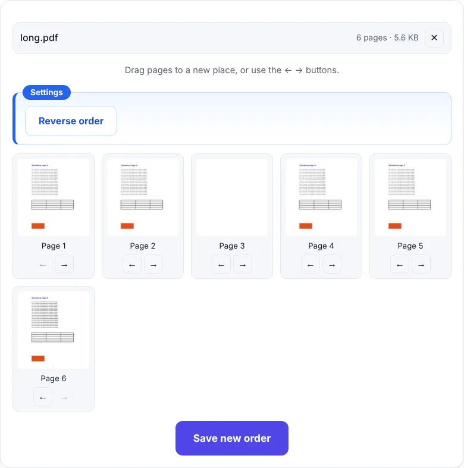

You scanned a form and page 3 came before page 1. Or you merged two PDFs and the annexure landed in the middle. You do not need to scan or merge again. You can **rearrange the pages of a PDF** in a minute by dragging them into the right order, for free, in your browser.

> **Short answer:** open [Reorder Pages](/reorder-pdf-pages/), drag the page thumbnails into the right order (or use the arrow buttons), click **Save new order**, then **Download PDF**.

## When you need to rearrange PDF pages

| Situation | What to do |
|---|---|
| Scanner or phone app saved pages in the wrong order | Drag the pages into place |
| Whole PDF is back to front (last page first) | Click **Reverse order** |
| Two PDFs merged in the wrong order | Drag the pages, or merge again in the right order |
| One page is upside down as well | Reorder first, then use [Rotate PDF](/rotate-pdf/) |
| An extra page is in the middle | Use [Remove Pages](/remove-pages/) after reordering |
| You need only a few pages, in a new order | Reorder, then use [Extract Pages](/extract-pages/) |

## How to rearrange PDF pages for free

1. Open **[Reorder Pages](/reorder-pdf-pages/)**.
2. Click **Choose PDF file** or drag your PDF into the box. A thumbnail of every page appears.
3. **Drag** a page thumbnail and drop it where it should go. Each thumbnail shows its original page number, so you can see what moved.
4. Or use the **← and →** buttons under a page to move it one place left or right.
5. Need the whole file flipped? Click **Reverse order**.
6. Click **Save new order**.
7. Click **Download PDF**. The new file has "reordered" in its name, and your original file is not changed.

## Rearranging pages on a phone

Drag and drop works best with a mouse. On a phone or tablet, the tool gives you arrow buttons instead:

1. Open the tool in Chrome or Safari and choose the PDF from your files or downloads.
2. Find the page that is in the wrong place.
3. Tap **←** to move it one place earlier, or **→** to move it one place later. Tap again until it is where you want it.
4. Tap **Save new order** and then **Download PDF**.

For long PDFs with many pages, a computer is more comfortable because you can drag a page across many places at once.

## Fixing a scanned PDF that is back to front

Many people scan a stack of papers from the bottom up, or a feeder scans the last page first. The result is a PDF where everything is in reverse.

1. Open the PDF in [Reorder Pages](/reorder-pdf-pages/).
2. Click **Reverse order** once. The thumbnails flip so that the last page is now first.
3. Check the thumbnails. If one or two pages are still out of place, drag them.
4. Click **Save new order** and download.

If you are making a new scan, you can avoid the problem by scanning pages in the order you want. See [how to scan documents to PDF with your phone](/guides/scan-documents-to-pdf-with-phone/).

## Rearranging pages after merging PDFs

When you join files, the pages follow the order of the files. If the order came out wrong, you have two choices:

- **Small fix:** open the merged PDF in Reorder Pages and drag the pages that are out of place.
- **Big fix:** go back to [Merge PDF](/merge-pdf/) and add the files in the right order. See the [guide to merging PDF files](/guides/how-to-merge-pdf-files/) for tips.

## What is kept and what is not

| Part of the PDF | After reordering |
|---|---|
| Text, pictures and stamps on each page | Kept exactly as before |
| Links on the pages | Kept |
| Page size and page rotation | Kept |
| Bookmarks (the outline panel) | Not copied to the new file |
| Password protection | Unlock the PDF first, then reorder |

The tool only changes the order of the pages. It does not redraw, compress or reduce the quality of any page.

If the PDF asks for a password when you open it, the tool will tell you. Remove the password with [Unlock PDF](/unlock-pdf/) if you know it, then try again.

## Tips before you upload the PDF

- **Check page numbers.** If your document has printed page numbers, compare them with the thumbnails before saving.
- **Look for blank pages.** Scans often pick up a blank back side. Remove them with [Remove Pages](/remove-pages/).
- **Check the size limit.** If a form portal asks for a small file, shrink the final PDF with [Compress PDF](/compress-pdf/). The size limit is different on each portal, so read the instructions on the official website.
- **Keep the original** until you have checked the new file page by page.
