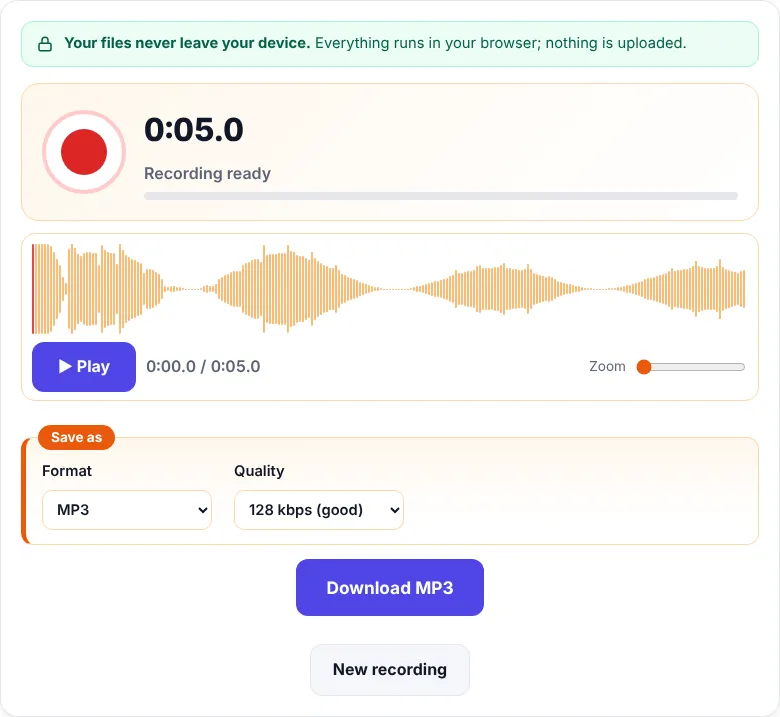

To record your voice online, open **[Voice Recorder](/voice-recorder/)**, press the red button, allow the microphone when your browser asks, speak, and press the stop button. Then listen to the recording and download it as MP3, WAV or M4A. It works on phones and laptops, and nothing is uploaded.

## What you can use it for

It is handy when you need a quick recording and do not want to install an app, for example:

- A voice note or self introduction for a job application or college form.
- Practising a speech, viva, interview answers or a presentation and listening back.
- Recording a song idea, a bhajan or a few lines for a family video.
- A short voice over for a reel, a school project or a slideshow.
- Reading out notes so you can listen to them later while travelling.

## Before you start

1. If you are not sure the microphone works, test it first with our **[Mic Test](/device-test/mic-test/)**.
2. Pick a quiet room and turn off the fan or cooler if you can. Soft things like curtains and a bed reduce echo.
3. Keep the mic at the same distance from your mouth. About a hand's width works well for a phone or headset mic.
4. Close other apps that use the mic, such as Zoom, Meet or WhatsApp calls.

## How to record your voice online

1. Open **[Voice Recorder](/voice-recorder/)**.
2. Under **Microphone**, keep **Default microphone** or choose another one, for example a headset.
3. Leave **Reduce noise and echo (best for voice)** ticked for speech. Untick it if you are recording music.
4. Press the red button. The first time, your browser asks to use the microphone. Click **Allow**.
5. Speak or sing. The timer runs and the level bar moves with your voice. Click **Pause** for a break and **Resume** to continue.
6. Press the stop button (the square). After a moment you see **Recording ready** and the waveform.
7. Click **Play** to listen.
8. Under **Save as**, choose the **Format** (MP3, WAV or M4A) and, for MP3 or M4A, the **Quality**. 128 kbps is selected at first.
9. Click the download button, for example **Download MP3**. The file is named with the date and time, like recording-2026-11-21-1030.mp3.

To record again, click **New recording**.

## Reading the level meter

The bar under the timer shows how loud your voice is at the mic, and its colour tells you when it is too loud.

| Bar colour | What it means | What to do |
|---|---|---|
| Green | Normal level | Keep going |
| Orange | Loud | Fine for short peaks, move back a little if it stays orange |
| Red | Very loud, close to the limit | Move the mic away or speak softer, or the sound may crack |
| Hardly moves | Too quiet | Move closer or check the input volume in your computer settings |

## Which format to choose

| Format | Best for | Notes |
|---|---|---|
| MP3 | WhatsApp, email, uploading to forms | Plays on almost every device |
| M4A | iPhone and Apple devices | Small files with good quality |
| WAV | Editing later | Full quality, but much bigger files |

If a form asks for a small file, MP3 at a lower quality like 64 or 96 kbps is usually enough for speech. To shrink a file you already saved, use **[Audio Compressor](/audio-compressor/)**. Our guide on [compressing an MP3 file](/guides/how-to-compress-mp3-file/) explains the sizes.

## Clean up the recording

- Trim silence at the start or end in **[MP3 Cutter](/mp3-cutter/)**.
- If it is too soft or uneven, bring it to a standard loudness with **[Audio Normalizer](/audio-normalizer/)**.
- If an app needs another format, change it with **[Audio Converter](/audio-converter/)**.

## Common problems

| Problem | What to try |
|---|---|
| "Microphone access was blocked" | Click the icon near the address bar, allow the microphone for this site and try again |
| "No microphone was found" | Plug in the mic or headset, then reload the page |
| The level bar does not move | Another app may be using the mic. Close it, or pick a different microphone |
| The voice sounds far away | Sit closer to the mic and choose a smaller room |
| Very long recording | Long recordings use more memory. For very long sessions, record in parts of up to an hour |

If the mic does not work in any app on your Windows laptop, follow our guide on [fixing a microphone that is not working on Windows](/guides/mic-not-working-windows/).

## Related guides

- [How to compress an MP3 file](/guides/how-to-compress-mp3-file/)
- [Microphone not working on Windows](/guides/mic-not-working-windows/)
