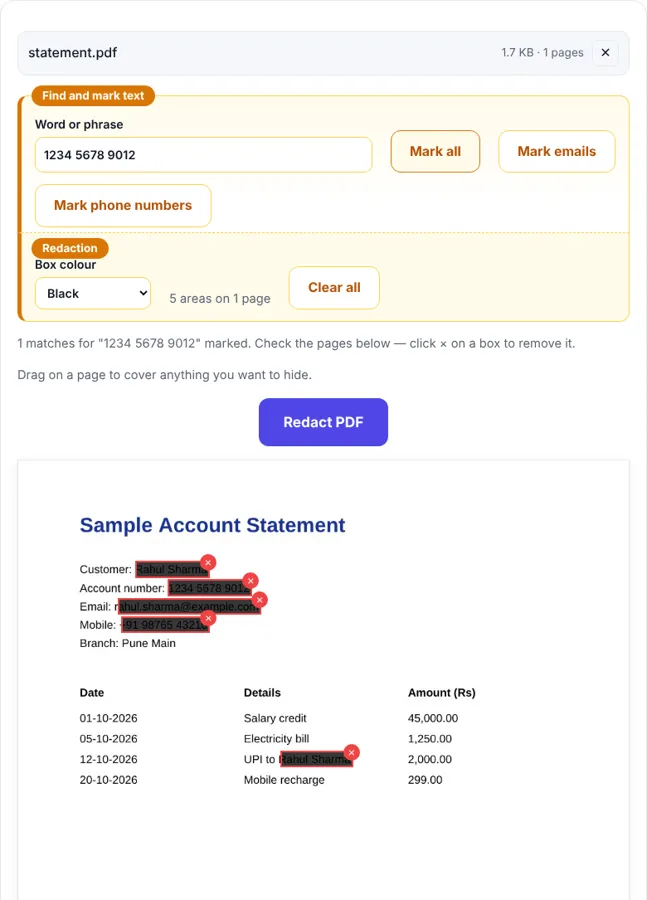

To redact a PDF, open **[Redact PDF](/redact-pdf/)**, choose your file, mark the text you want to hide with **Mark all** or by dragging boxes, then click **Redact PDF** and download the safe copy. The marked text is removed from the file for good, not just covered. It is free and the PDF never leaves your device.

## Why a black box is not enough

Many people hide an account number by drawing a black rectangle in Word, a PDF editor or a phone markup app. It looks hidden, but in many cases the text is still inside the file:

| Method | Looks hidden? | Text still in the file? |
|---|---|---|
| Black highlight or shape in a PDF editor | Yes | Often yes, it can be copied or searched |
| Black box in Word, then saved as PDF | Yes | Often yes, the text is under the shape |
| Marker on a printed page, then scanned | Yes | No, but a light marker may show through |
| Proper redaction | Yes | No, the text is removed |

So if you share a bank statement, salary slip, ID copy or legal paper, use a real redaction tool and then check the result.

## How to redact a PDF for free

1. Open **[Redact PDF](/redact-pdf/)**.
2. Click **Choose PDF file** and pick your PDF. Every page is shown below the options.
3. Mark what you want to hide:
   - Type a word, name or number in **Word or phrase** and click **Mark all**. Every match on every page gets a box.
   - Click **Mark emails** to box every email address.
   - Click **Mark phone numbers** to box long numbers that look like phone numbers.
   - Drag on a page with your mouse or finger to cover anything else, such as a photo, signature or stamp.
4. Check every page. Remove a box you do not need with the **×** on its corner, or use **Clear all** to start again.
5. Choose the **Box colour**: **Black** or **White**.
6. Click **Redact PDF**, then **Download PDF**. The new file ends with "-redacted".

Your original PDF is not changed.

## What happens to the redacted pages

ZentaPDF works in a simple and safe way:

- **Pages with a box** are redrawn as an image with the box burned in. The text, numbers and pictures under the box are gone from the file.
- **Pages without a box** are copied as they are, so their text stays selectable.
- **Document details** such as title, author, subject and keywords are cleared from the new file.

Because redacted pages become images, their text can no longer be selected or searched. If the file gets bigger, you can shrink it with **[Compress PDF](/compress-pdf/)**.

## What to redact in common Indian documents

| Document | What people usually hide |
|---|---|
| Bank statement | Account number, other people's names, UPI IDs, balance if not needed |
| Salary slip | Bank account number, PAN, UAN, employee ID |
| Aadhaar copy | The first 8 digits of the Aadhaar number, QR code if not needed |
| Rent agreement | Phone numbers, address of the other party, signatures |
| Medical report | Patient ID, phone number, address |
| Court or legal papers | Names of children or witnesses, as your lawyer advises |

Always share only what the other side really needs. Some offices, banks and courts have their own rules about what must stay visible, so check their instructions before you redact.

**About Aadhaar:** UIDAI offers a **masked Aadhaar**, where the first 8 digits are replaced with "xxxx-xxxx" and only the last 4 digits are shown. You can choose it when you download your e-Aadhaar from the official UIDAI site. If you need help opening that file, see the [Aadhaar PDF password guide](/guides/aadhaar-card-pdf-password/).

## Tips for clean redaction

- **Search more than one way.** A number may be written as 1234 5678 9012 in one place and 123456789012 in another. Search for both.
- **Check the phone number boxes.** **Mark phone numbers** looks for long groups of digits, so it can also mark dates or other long numbers. Remove any extra box with **×**.
- **Look for the same name in tables.** Names often appear again in transaction lists, signatures and footers.
- **Scanned pages need boxes by hand.** The search buttons can only find typed text, so drag boxes over scanned parts.
- **Up to 150 pages.** For a bigger file, split it first with **[Split PDF](/split-pdf/)**, redact the pages you need and join them again with **[Merge PDF](/merge-pdf/)**.

## Check your redacted PDF before sharing

1. Open the downloaded file in your PDF reader.
2. Press Ctrl + F (or use search on your phone) and search for the name or number you hid. It should not be found.
3. Try to select the hidden area. On redacted pages nothing can be selected.
4. Zoom in on each box to make sure no letters peek out at the edges.

If the file still has something private, go back, click **Keep editing**, add a box and redact again.

## After redacting

- **Need a password too?** Lock the safe copy with **[Protect PDF](/protect-pdf/)**. See [how to password protect a PDF](/guides/how-to-password-protect-pdf/).
- **Form fields still editable?** Use **[Flatten PDF](/flatten-pdf/)** so filled fields cannot be changed.
- **Want to check document details?** Open the file in **[Edit PDF Metadata](/edit-pdf-metadata/)**.
