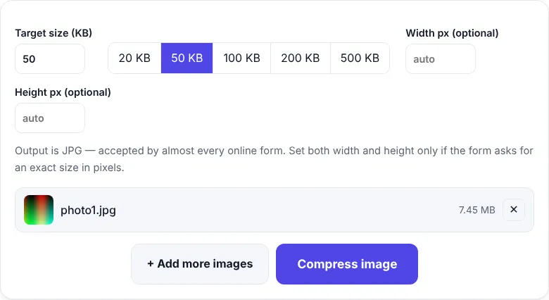

Exam, job, scholarship, passport and bank forms often have strict rules like *"Photo: JPG, 20–50 KB"* or *"Signature: 10–20 KB"*. Phone photos are usually **2–5 MB**, so they get rejected. Here's how to get your photo and signature to the exact size — free and in a minute.

> **Always check the official notification** of the form you are filling. Size limits, pixel sizes and background rules are different for every exam and website.

## Typical requirements (examples)

| Item | Common size limits | Common format |
|---|---|---|
| Passport-size photo | 20–50 KB, sometimes up to 100–200 KB | JPG |
| Signature | 10–20 KB, sometimes up to 50 KB | JPG |
| Certificates / documents | 100 KB – 1 MB | JPG or PDF |

## Step 1 – Take a good photo

- Stand against a **plain white or light background**.
- Face the camera, good daylight, no shadows on the face.
- For signatures: sign with a **black or blue pen on white paper**, and photograph it from straight above.

## Step 2 – Crop it

Use **[Crop Image](/crop-image/)** to cut away extra background. For passport-style photos, choose a ratio close to the form's (many use 3.5 × 4.5, which is close to **3:4**). For signatures, crop tightly around the ink.

## Step 3 – Reduce the size in KB

1. Open **[Reduce Image Size in KB](/reduce-image-size-in-kb/)**.
2. Choose your photo or signature.
3. Type the **target size** (e.g. 50) or tap **20 / 50 / 100 / 200 KB**.
4. If the form asks for exact pixels (e.g. **200 × 230**), type the **width** and **height**.
5. Click **Compress** and download.

The tool tries the **highest quality that fits** your target and only reduces pixels if it really has to — so your photo stays as clear as possible.

Shortcuts: [20 KB](/compress-image-to-20kb/) · [50 KB](/compress-image-to-50kb/) · [100 KB](/compress-image-to-100kb/) · [200 KB](/compress-image-to-200kb/)

## Minimum size too?

Some forms say *"between 20 KB and 50 KB"*. If your result is **below the minimum**, set a target closer to the upper limit (e.g. 45 KB), or increase the pixel size slightly.

## Common reasons photos get rejected

| Problem | Fix |
|---|---|
| File too large | Reduce the KB target |
| Wrong format (PNG/HEIC) | The tool always outputs **JPG** |
| Wrong pixel size | Enter exact width and height |
| Blurry face | Use a sharper original photo, crop before compressing |
| Coloured or dark background | Retake the photo against a light wall |

## iPhone photos (HEIC)

iPhones often save photos as **HEIC**. Our KB tools accept HEIC directly and save JPG. You can also convert with [HEIC to JPG](/heic-to-jpg/), or change *Settings → Camera → Formats → Most Compatible* so new photos are saved as JPG. See also: [passport size photo for online forms](/guides/passport-size-photo-for-online-forms/).

## Compressing a signature (step by step)

1. Sign 2–3 times on plain white paper with a black or dark-blue pen and pick the best one.
2. Take a photo straight from above in daylight, without shadows.
3. Crop tightly around the signature with [Crop Image](/crop-image/). Many forms want a wide shape, roughly **3:1**.
4. Open [Compress Image to 20KB](/compress-image-to-20kb/) (or the limit your form asks for) and compress.
5. Zoom in on the result — the signature should be clear and dark, with a white background.

## Reducing size without losing quality

- **Crop first.** Removing extra background reduces the file size a lot.
- **Use the exact pixels the form asks for.** A 200 × 230 px photo easily fits in 20–50 KB with high quality.
- **Start from a sharp photo.** Compression can't fix blur.
- **Don't compress twice.** Always start again from the original photo if you need a different size.

## Photo size in KB vs size in pixels vs size in cm

Forms mix these up, so it helps to know the difference:

| Term | Meaning | Example |
|---|---|---|
| **KB (file size)** | How much storage the file uses | 45 KB |
| **Pixels** | Width × height of the image | 200 × 230 px |
| **cm / inches** | Printed size, depends on DPI | 3.5 × 4.5 cm |

A printed **3.5 × 4.5 cm** photo at 200 DPI is about **276 × 354 pixels**. If a form only gives centimetres, you can calculate pixels as *cm ÷ 2.54 × DPI*.

