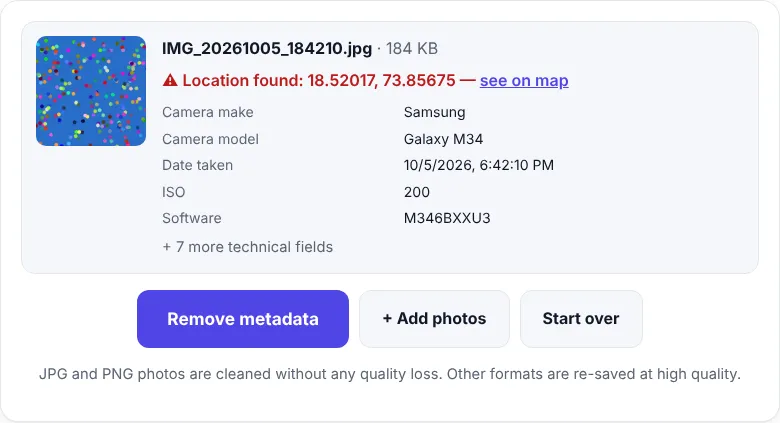

Every photo you take on a phone can carry hidden details called **EXIF data** (or metadata). It can include the exact **GPS location** where the photo was taken, the date and time, and the phone model. If you share the original file, anyone can read these details. You can remove them for free in your browser in a few seconds.

> **Short answer:** open [Remove Photo Metadata](/remove-exif-data/), choose your photos, click **Remove metadata** and download the clean copies.

## What hidden data a photo can contain

Not every photo has all of this. It depends on your phone, camera app and settings.

| Data | Example | Why it matters |
|---|---|---|
| GPS location | 18.52017, 73.85675 | Can point to your home, office or your child's school |
| Date and time taken | 5 Oct 2026, 6:42 PM | Shows when you were at a place |
| Camera make and model | Samsung Galaxy M34 | Tells people which phone you use |
| Software | Editing app or phone firmware | Shows how the photo was made or edited |
| Camera settings | ISO, exposure, focal length | Mostly harmless, but still personal data |
| Author or owner name | Set in some cameras | Can show your name |

The GPS location is the most sensitive part. A single photo of your new house or your car, sent as a file, can reveal the exact spot on a map.

## How to remove EXIF data and location from a photo

1. Open **[Remove Photo Metadata](/remove-exif-data/)** on your phone or computer.
2. Click **Choose photos** or drag your photos into the box. You can pick many at once. JPG, PNG, WebP and HEIC are accepted.
3. Look at the details for each photo. A red line **Location found** means the photo has a GPS location, and **see on map** opens that spot in Google Maps. A green line means no location was found.
4. Click **Remove metadata**.
5. Click **Download clean photo** under any photo, or use the main button to save all of them. With more than one photo you get a ZIP file.

The clean copy has **no-metadata** at the end of its name, for example IMG_2041-no-metadata.jpg. Your original photo is not changed. The photos are processed inside your browser and are not uploaded.

Want to only check a photo without changing it? Use [EXIF Viewer](/exif-viewer/).

## What happens to each photo format

| Format | What the tool does | Quality |
|---|---|---|
| JPG | Removes the EXIF, XMP and comment blocks, keeps the colour profile | Same as before |
| PNG | Removes text, EXIF and time blocks | Same as before |
| JPG that uses stored rotation | Saves the photo upright, then without metadata | High quality re-save |
| WebP | Re-saves the picture, which drops all metadata | High quality re-save |
| HEIC (iPhone) | Re-saves the photo as JPG without metadata | High quality re-save |

If your iPhone photos are in HEIC and a website will not accept them, you may also like our [HEIC to JPG guide](/guides/how-to-convert-heic-to-jpg/).

## When you should remove photo metadata

- **Selling things online.** Photos of a bike, phone or furniture are often taken at home.
- **Posting photos of children**, especially near the home or school.
- **Sending photos to people you do not know**, such as buyers, tenants or new contacts.
- **Sharing photos as documents** on WhatsApp or Telegram, or by email, Google Drive or a pen drive. These usually send the original file with all its data.
- **Uploading screenshots or scanned documents** to public sites.

Social media apps and chat apps may remove some or all of this data on their own, but each app works differently and can change over time. Cleaning the file yourself is the safe way.

## How to stop your phone saving location in new photos

Removing data from old photos is one step. You can also stop the camera adding a location in the first place.

**iPhone**

1. Open **Settings**, then **Privacy & Security**, then **Location Services**.
2. Tap **Camera** and choose **Never**.

To share one photo without its location, tap **Share**, then **Options**, and turn off **Location**. You will see "Location Not Included" before you share.

**Android**

The setting is inside the camera app and its name differs by brand. Open the camera, go to its **Settings** and look for an option such as **Location tags** or **Save location**, then turn it off. Google Photos also lets you edit or remove the location of a photo from its details screen.

## Tips after cleaning your photos

- **Check again.** Open the clean photo in [EXIF Viewer](/exif-viewer/). It should show no location.
- **Photo too big for a form?** Shrink it with [Compress Image](/compress-image/) or get an exact size with [Reduce Image Size in KB](/reduce-image-size-in-kb/). For exam forms, see our [passport size photo guide](/guides/passport-size-photo-for-online-forms/).
- **Look at the picture itself.** Removing metadata does not hide a house number, vehicle number plate, school uniform or shop name that is visible in the photo. Crop or blur those before sharing.
- **Keep the originals private.** Your gallery copy still has the location, which is useful for your own memories. Just share the clean copy.
