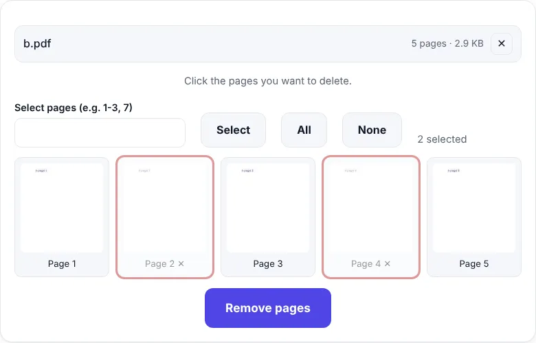

Blank pages from a scanner, an old cover page, or that one page with information you don't want to share — removing pages from a PDF is one of the most common PDF jobs. Here's the fastest way.

## How to remove pages (step by step)

1. Open **[Remove Pages](/remove-pages/)**.
2. Choose your PDF. Every page appears as a **thumbnail**.
3. **Click the pages to delete** — they turn red and faded. Or type pages such as `2, 5-7` and press **Select**.
4. Click **Remove pages**.
5. Click **Download PDF**.

## Typing page ranges

| You type | Selected pages |
|---|---|
| `3` | page 3 |
| `1-4` | pages 1, 2, 3, 4 |
| `2, 5-7, 10` | pages 2, 5, 6, 7, 10 |
| `8-end` | page 8 to the last page |

Use **All** and **None** to select or clear everything quickly.

## Remove or extract?

- **Remove Pages** – delete a few pages, keep the rest.
- **[Extract Pages](/extract-pages/)** – keep a few pages, drop the rest.

If you need to delete 40 pages out of 50, it's easier to *extract* the 10 you want to keep.

## Other things you might want to do

- **Wrong order?** Use [Reorder Pages](/reorder-pdf-pages/) to drag pages into place.
- **Sideways page?** Fix it with [Rotate PDF](/rotate-pdf/).
- **Need separate files?** [Split PDF](/split-pdf/) creates one PDF per range or per page.

## Removing pages on a phone

Open [zentapdf.com/remove-pages/](/remove-pages/) in Chrome or Safari, tap **Choose PDF file**, tap the pages to delete and download. Thumbnails make it easy to see what you're removing.

## Does it reduce quality?

No. The remaining pages are copied exactly as they are — text, images and links stay the same. The file usually gets smaller because fewer pages are left.

## When should you remove pages?

Some common situations:

- **Job applications** – remove old certificates or irrelevant pages so the recruiter sees only what matters.
- **Scanned documents** – scanners often add blank back sides. Removing them can halve the page count.
- **Sharing part of a report** – send a client only the pages that concern them.
- **Privacy** – delete pages with account numbers, addresses or signatures before sharing a document publicly.
- **Upload limits** – fewer pages means a smaller file. Combine with [Compress PDF](/compress-pdf/) if it's still too big.

## Removing pages from many PDFs

Need to clean up several files? Handle them one by one, or first combine them with [Merge PDF](/merge-pdf/), remove the unwanted pages in one go, and then [split](/split-pdf/) them again if needed.

## Other ways to remove pages

| Method | Pros | Cons |
|---|---|---|
| **Mac Preview** | Built in on Mac | Mac only |
| **"Print to PDF" with a page range** | Built into Windows and browsers | Links and form fields are lost; text may become less sharp |
| **Paid PDF software** | Many features | Costs money, needs installation |

The "Print to PDF" trick works in a pinch, but it re-creates the document instead of copying pages, so ZentaPDF's method keeps your PDF closer to the original.

## Mistakes to avoid

- **Check the thumbnails carefully** before removing — page numbers in the document's footer don't always match the real page order.
- **Keep the original file** until you've checked the new one.
- If the PDF is **password-protected**, unlock it first with [Unlock PDF](/unlock-pdf/) using the password you know.

