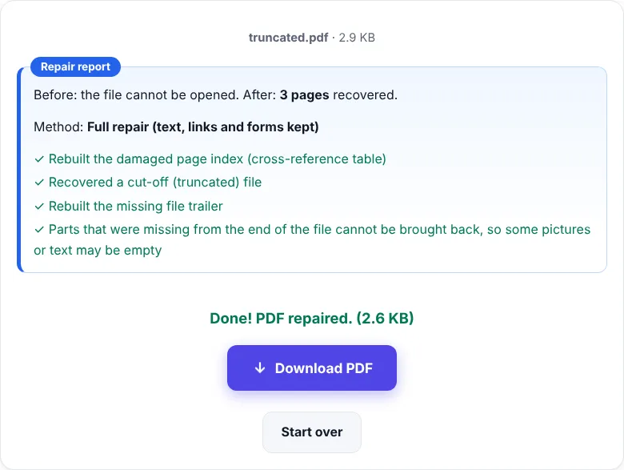

You double click a PDF and get a message like **"The file is damaged and could not be repaired"**, **"Failed to load PDF document"** or just a blank screen. The file is not always lost. In many cases only the internal index of the file is broken and the pages are still inside.

## Why PDF files get corrupted

| Cause | What usually happens |
|---|---|
| Download stopped halfway | The end of the file is missing, so the reader cannot find the page index |
| Email or chat app changed the file | Some bytes are altered while sending or saving |
| Pen drive removed too early | The file was not fully written to the drive |
| Old or buggy PDF software | The file was saved with wrong internal values |
| Disk or memory card errors | Parts of the file are unreadable |

A PDF has a table at its end that tells the reader where every page and picture is stored. If that table is damaged or missing, the reader gives up, even though most of the content is still there.

## How to repair a PDF for free

1. Open **[Repair PDF](/repair-pdf/)**.
2. Choose the damaged PDF or drag it into the box.
3. The repair starts by itself. Wait a few seconds.
4. Read the **repair report**. It shows how many pages were recovered and what was fixed.
5. Click **Download PDF** and open the repaired copy.

Your original file is not changed.

## What the three repair methods do

Repair PDF tries three methods, one after another, and stops at the first one that recovers every page:

| Method | What it does | What you keep |
|---|---|---|
| 1. Full repair | Rebuilds the page index by scanning the whole file | Text, links, forms and pictures |
| 2. Object by object | Reads each part of the file and skips the broken ones | Text and pictures from the readable parts |
| 3. Redraw pages | Draws every readable page again as an image | The look of each page, but text is no longer selectable |

Most damaged PDFs are fixed by the first method.

## What can and cannot be recovered

**Usually fixable**

- PDFs with a broken or missing page index
- Files that show "damaged" or "could not be opened" but have the right size
- Files saved with wrong internal lengths by older software

**Hard or impossible to fix**

- A download that stopped very early. The missing part never reached your device, so no tool can bring it back. Download the file again if you can.
- Files that are not really PDFs, for example a web page saved with a .pdf name.
- Files where the damaged part holds the only copy of a page.

## Tips after repairing

- **Check every page.** Scroll through the repaired PDF before you delete the original.
- **File too big now?** Shrink it with [Compress PDF](/compress-pdf/).
- **Need images of the pages?** Use [PDF to JPG](/pdf-to-jpg/).
- **Asks for a password?** That is protection, not damage. Use [Unlock PDF](/unlock-pdf/) if you know the password. For Aadhaar, see the [Aadhaar PDF password guide](/guides/aadhaar-card-pdf-password/).

## How to avoid corrupted PDFs

- Wait for downloads to finish completely before opening them.
- Use "Safely remove" or "Eject" before pulling out a pen drive.
- Keep a second copy of important files in cloud storage or email.
- When a portal or app shows an error, download the PDF again before you try anything else.
