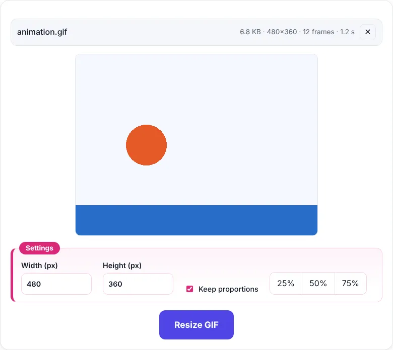

You want to use a GIF as a profile picture, a sticker, an email signature or on your website, but it is too big. When you resize it in a normal photo app, the GIF often **stops moving** and becomes a still image. The fix is to use a tool that resizes **every frame** of the GIF, not just the first one.

> **Short answer:** open [Resize GIF](/resize-gif/), choose your GIF, type a new width or height (or click 25%, 50% or 75%), click **Resize GIF** and download. All frames and their timing are kept.

## Why GIFs lose their animation when resized

An animated GIF is a set of pictures (frames) shown one after another, with a short delay between them. Many apps that edit photos open only the first frame. When you save, the other frames are dropped and you get a still picture.

| Tool you used | What usually happens |
|---|---|
| Basic photo editor or gallery app | Only the first frame is kept, the GIF stops moving |
| Screenshot of the GIF | You get one still frame as PNG or JPG |
| A GIF tool such as Resize GIF | Every frame is resized and the timing stays the same |

## How to resize an animated GIF

1. Open **[Resize GIF](/resize-gif/)**.
2. Click **Choose GIF file** or drop your GIF into the box. You will see its size in pixels, the number of frames and its length in seconds.
3. Type a new **Width (px)** or **Height (px)**. With **Keep proportions** ticked, the other side changes by itself so the GIF does not look stretched.
4. Or click a quick size: **25%**, **50%** or **75%**.
5. Click **Resize GIF**.
6. Check the preview. It plays the new GIF so you can see the animation still works.
7. Click **Download GIF**. Not happy? Click **Change settings** and try another size.

## Which size should you choose?

There is no single right size. It depends on where the GIF will be used. Use this table as a starting point and then check the rules of the app or website you are uploading to, because each one has its own limits.

| Where you will use it | What to aim for |
|---|---|
| Profile picture or avatar | Small and square. Crop to a square first, then resize |
| Chat sticker or emoji | Very small in pixels, and a light file |
| Email signature | Small, so the email loads fast on phones |
| Blog post or website | No wider than the space it will fill on the page |
| Presentation slide | About the size it will appear on the slide |

A good habit is to resize to the exact size the GIF will be shown at. A bigger GIF than needed only makes the file heavier.

## Resize, crop or compress: which one do you need?

These three tools do different jobs, and you can use them one after another.

| You want to | Use | What changes |
|---|---|---|
| Make the whole GIF smaller or bigger | [Resize GIF](/resize-gif/) | Width and height, same shape |
| Cut away the edges or make it square | [Crop GIF](/crop-gif/) | Shape and area shown |
| Make the file lighter in KB or MB | [Compress GIF](/compress-gif/) | Colours and number of frames |

A common order is **crop first, then resize, then compress** if the file is still too big.

## How to make a GIF square without stretching it

If you type the same width and height for a wide GIF, the picture gets squashed. To get a clean square:

1. Open **[Crop GIF](/crop-gif/)** and choose your GIF.
2. Pick **Square 1:1** in the Shape list. The box is placed in the centre.
3. Drag the box to the part you want to keep.
4. Click **Crop GIF** and download.
5. Open the cropped GIF in **Resize GIF** and set the size you need.

Every frame is cropped in the same place, so the animation stays smooth.

## Tips for a sharp and light GIF

- **Make it smaller, not bigger.** Shrinking a GIF keeps it sharp. Enlarging a small GIF can make it look blurry.
- **Keep proportions ticked** unless you really want to stretch the picture.
- **Check the file size** shown after resizing. If it is still too heavy, run it through [Compress GIF](/compress-gif/).
- **Need a still picture instead?** If the website does not accept GIFs, save one frame as an image with [GIF to JPG](/gif-to-jpg/) and resize it with [Resize Image](/resize-image/).
- **Choosing a format?** See [JPG vs PNG vs WebP](/guides/jpg-vs-png-vs-webp/) to know when a GIF is the right choice and when it is not.

## Is it safe to resize GIFs online here?

Resize GIF works inside your browser. The GIF is read and resized on your own device, which is why the result appears quickly even for GIFs with many frames. It is free to use and you do not need to sign up.
