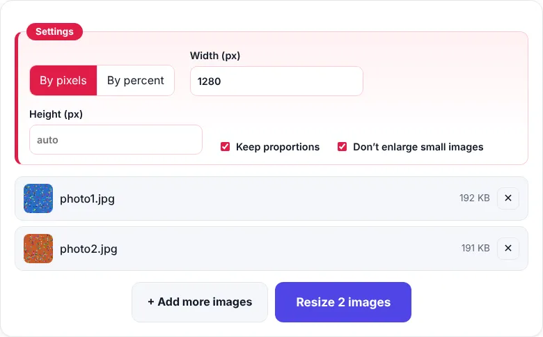

Resizing an image changes its width and height in pixels. You need it when a website or form asks for a photo of a certain size, when a phone photo is too big to share, or when a set of product photos must all be the same width. You can do it in the browser on any phone or computer, without installing an app.

> **Short answer:** open [Resize Image](/resize-image/), choose your photo, pick **By pixels**, type the **Width (px)** and **Height (px)** you need (or only one of them), and click **Resize image**. Then click **Download image**.

## How to resize an image in pixels

1. Open **[Resize Image](/resize-image/)**.
2. Click **Choose images** or drag your photos into the box. JPG, PNG, WebP, GIF and iPhone HEIC photos work.
3. Keep **By pixels** selected.
4. Type the **Width (px)**. The tool starts at 1280. Leave **Height (px)** empty to work it out from the width.
5. Leave **Keep proportions** ticked so the photo does not look stretched.
6. Click **Resize image**. Next to each file you see the old and new size, for example 4000×3000 → 1280×960.
7. Click **Download image**, or **Download all (ZIP)** if you added more than one photo.

The new file gets "-resized" added to its name. Your original photo is not changed.

## Resize by percent

Choose **By percent** when you just want the photo smaller or bigger, without a fixed size in mind.

1. Choose your photos and click **By percent**.
2. Move the **Size** slider. It goes from 5% to 200% in steps of 5. At 50%, a 4000×3000 photo becomes 2000×1500.
3. Click **Resize image** and download.

Going above 100% only works if you untick **Don't enlarge small images**.

## What Keep proportions does

| Settings | What happens to a 4000×3000 photo |
|---|---|
| Width 1280, Height empty, Keep proportions on | 1280×960. The height follows the width |
| Width 1280, Height 1280, Keep proportions on | 1280×960. It fits inside a 1280×1280 box without changing shape |
| Width 1280, Height 1280, Keep proportions off | 1280×1280. The photo is squeezed into a square and looks stretched |
| Width 6000, Height empty, Don't enlarge on | 4000×3000. It stays at its original size |
| By percent 25% | 1000×750 |

If a form needs an exact square or a different shape from your photo, crop it to that shape first with [Crop Image](/crop-image/), then resize it. That way nothing gets stretched. The [crop image guide](/guides/how-to-crop-image/) shows how to crop to exact pixels.

## Size in pixels is not the same as size in KB

Pixels are the width and height of the picture. KB or MB is how much space the file takes. A smaller photo in pixels usually has a smaller file, but online forms often set both limits, for example a width and height in pixels and a maximum of 50 KB.

| The form asks for | Use |
|---|---|
| A width and height in pixels | [Resize Image](/resize-image/) |
| A maximum file size in KB | [Reduce Image Size in KB](/reduce-image-size-in-kb/) |
| Both | Resize first, then reduce the KB |
| A size in cm or inches for printing | See the [passport size photo guide](/guides/passport-size-photo-for-online-forms/) |

The [reduce image size in KB guide](/guides/how-to-reduce-image-size-in-kb/) explains the KB part step by step. Every exam, job and government portal sets its own photo and signature rules, so read the official instructions of the form you are filling before you resize.

## Sizes for YouTube and other sites

Websites and social media apps set their own sizes and change them from time to time, so check the platform's help page when the exact size matters. YouTube, for example, asks for video thumbnails in a 16:9 shape with a width of at least 640 pixels, and suggests making them as large as possible. A 1280×720 image is 16:9 and wide enough.

## Which format the resized image is saved in

JPG, PNG and WebP photos stay in the same format. JPG and WebP are saved at high quality (92 percent), so the photo looks the same apart from the size. GIF, AVIF, BMP and iPhone HEIC photos are saved as PNG. To pick a different format, convert the result with [Convert Image](/convert-image/).

A resized GIF keeps only one frame. To resize an animated GIF and keep the animation, use [Resize GIF](/resize-gif/).

## Tips for sharp results

- Start from the original photo, not a WhatsApp forward or a screenshot. Forwarded photos already have fewer pixels.
- Making a photo smaller keeps it sharp. Making it bigger cannot add detail, so a small photo blown up looks soft.
- Resize before you compress. With fewer pixels the compressed file comes out smaller.
- If the file is still too big after resizing, use [Compress Image](/compress-image/).
