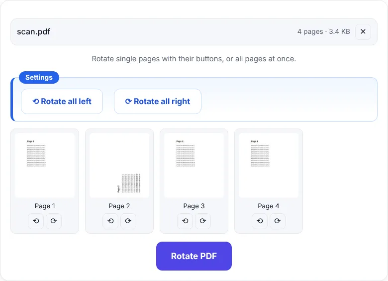

To rotate a PDF and save it, open **[Rotate PDF](/rotate-pdf/)**, choose your file, turn all pages or only the sideways ones with the rotate buttons, then click **Rotate PDF** and **Download PDF**. The new file opens the right way up in every PDF reader, on any phone or computer.

> **Short answer:** the rotate button in a PDF viewer only changes your screen. To fix the file itself, rotate the pages in a tool that saves a new PDF.

## Why the rotation does not stay

This is the most common problem. You rotate a page in Chrome, Edge or Adobe Acrobat Reader, close the file, open it again, and it is sideways once more.

That happens because these buttons usually change only the **view**. In the free Adobe Acrobat Reader, for example, **Rotate View** turns what you see, but the file is not changed. Rotating pages for good needs the paid Acrobat or a separate tool.

| Where you rotated | What it changes | Saved in the file? |
|---|---|---|
| Rotate button in a browser PDF viewer | Only your screen | Usually no |
| Rotate View in Adobe Acrobat Reader (free) | Only your screen | No |
| Rotate Pages in paid Adobe Acrobat | The file | Yes, after you save |
| ZentaPDF Rotate PDF | A new copy of the file | Yes, in the downloaded PDF |

## When you need to rotate a PDF

- A **scanned page** came out sideways or upside down.
- A **phone scan** of a certificate or Aadhaar card is turned the wrong way.
- One **landscape table** or chart sits inside a portrait report.
- Pages were **merged** from different files and some are turned.
- An upload portal shows your document sideways in its preview.

## How to rotate all pages of a PDF

1. Open **[Rotate PDF](/rotate-pdf/)**.
2. Click **Choose PDF file** or drop the PDF into the box. A small picture of every page appears.
3. Click **Rotate all right** to turn every page 90 degrees clockwise, or **Rotate all left** to turn them anticlockwise.
4. Click the same button again to turn a further 90 degrees. Two clicks turn an upside down file the right way up.
5. When all the thumbnails look correct, click **Rotate PDF**.
6. Click **Download PDF**. The new file is saved with "rotated" added to the name.

Your original file is not changed. You can open the new PDF to check it before you send it.

## How to rotate only one page

Often only one page is wrong, such as a landscape table in a portrait file. You do not need to turn the whole document.

1. Open **[Rotate PDF](/rotate-pdf/)** and choose the file.
2. Find the page that is sideways in the thumbnails.
3. Use the **⟲** button under that page to turn it left, or **⟳** to turn it right.
4. Leave every other page as it is.
5. Click **Rotate PDF** and then **Download PDF**.

You can mix both ways. For example, click **Rotate all right** first, then turn one page back with its own button.

## Which way to turn: a quick guide

| How the page looks now | What to click |
|---|---|
| Text runs from bottom to top | Rotate right once |
| Text runs from top to bottom | Rotate left once |
| Page is upside down | Rotate right twice (or left twice) |
| Page is correct | Do nothing |

The thumbnails turn as you click, so you can see the result before you save.

## Rotate a PDF on your phone

The tool runs in your phone browser, so there is no app to install.

1. Open zentapdf.com/rotate-pdf/ in Chrome on Android or Safari on iPhone.
2. Tap **Choose PDF file** and pick the PDF from Files, Downloads or WhatsApp documents.
3. Tap the rotate buttons until every page looks right.
4. Tap **Rotate PDF** and then **Download PDF**.

The file is processed on your own device. It is not uploaded to a server.

## Other fixes you may need after rotating

Rotating is often one step in cleaning up a scanned or merged file:

- **Pages in the wrong order:** use [Reorder PDF Pages](/reorder-pdf-pages/). Our guide on [how to rearrange PDF pages](/guides/how-to-rearrange-pdf-pages/) explains drag and drop and reverse order.
- **Extra or blank pages:** delete them with [Remove Pages](/remove-pages/).
- **Several files to join:** fix the rotation in each file, then combine them with [Merge PDF](/merge-pdf/).
- **The page is a photo, not a PDF:** turn the photo with [Rotate Image](/rotate-image/) first, then convert it.
- **Mixed page sizes after merging:** see [how to change PDF page size from Letter to A4](/guides/how-to-change-pdf-page-size-letter-to-a4/).

## Tips for a clean result

- **Check every page.** In long scans one page in the middle is often turned. Scroll through all thumbnails before you click Rotate PDF.
- **Password protected PDF?** The tool asks you to unlock it first. Use [Unlock PDF](/unlock-pdf/) with the password you know.
- **Scanning again soon?** Hold the phone straight above the page so the scanner app does not guess the wrong direction.
- **Uploading to a portal?** Open the rotated PDF once before upload to make sure every page reads from top to bottom.
