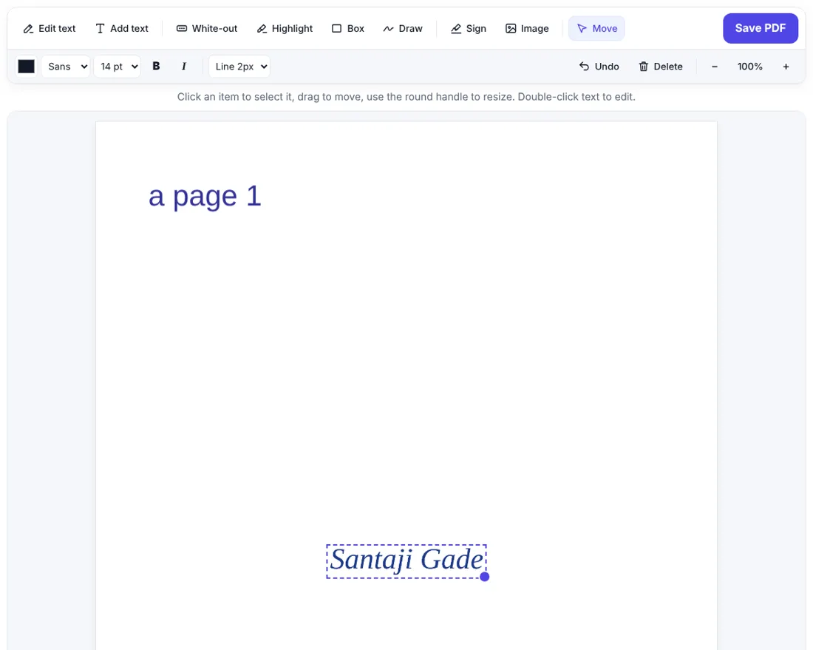

Printing a document, signing it with a pen, scanning it and emailing it back takes ten minutes and a printer you may not have. You can do the same thing **in under a minute** directly on your computer or phone — and the result looks cleaner too.

## What you need

- The PDF you need to sign.
- Your signature — you can **draw** it, **type** it, or **upload** a photo of it.
- A web browser. No app, account or printer needed.

## How to sign a PDF (step by step)

1. Open **[Sign PDF](/sign-pdf/)** on ZentaPDF and choose your PDF.
2. The signature window opens automatically. Pick one way:
   - **Draw** – sign with your mouse, touchpad, finger or stylus.
   - **Type** – type your name and choose a handwriting style.
   - **Upload** – use a photo or scan of your real signature.
3. Choose ink colour (blue or black looks most natural) and click **Use signature**.
4. **Drag** the signature to the signature line and **resize** it with the round handle.
5. Need the date or your name? Click **Add text**, click on the page and type.
6. Click **Save PDF**, then **Download PDF**.

## Tips for a signature that looks real

- **Draw slowly and large.** A big signature scaled down looks smoother than a small one.
- **Use a stylus or your finger on a phone** — it feels most like a pen.
- **Upload a clean photo:** sign on plain white paper with a dark pen, take the photo in good light, and crop it close to the signature. A PNG with a transparent background looks best.
- **Blue ink** makes it obvious the document was signed, not photocopied.

## Signing on a phone

Open [zentapdf.com/sign-pdf/](/sign-pdf/) in Chrome or Safari, choose the PDF from your files or downloads, draw with your finger and place the signature. Zoom in with the **+** button for accurate placement. When you save, the signed PDF is downloaded to your phone, ready to share on email or WhatsApp.

## Make the signature permanent

The signature is drawn onto the page itself, so it cannot simply be clicked and moved by the person you send it to. For extra safety:

- If the PDF is a **fillable form**, run it through [Flatten PDF](/flatten-pdf/) after signing so the answers can't be changed.
- To stop others from opening it, add a password with [Protect PDF](/protect-pdf/).

## Electronic signature vs digital signature

| | Electronic signature (this guide) | Digital signature (DSC) |
|---|---|---|
| What it is | An image of your signature on the page | A cryptographic certificate linked to your identity |
| Cost | Free | Paid certificate from an authority |
| Typical use | Forms, letters, approvals, rental papers, HR documents | Tax filings, company filings, tenders, legal e-filing |

For most everyday paperwork an electronic signature is enough. If an official portal specifically asks for a **digital signature certificate**, you need that instead.

## Signing a PDF that needs several signatures

- **Initials on every page?** Create the signature once, then click **Sign** again on each page — or draw your initials as a separate small signature.
- **Two people signing?** The first person signs and sends the downloaded PDF; the second person opens that file and adds their signature.
- **Add a stamp?** Upload a photo of your company stamp with **Image** and place it next to the signature.

## Common mistakes

| Mistake | Better |
|---|---|
| Signature too small to read | Make it at least as wide as the signature line |
| Grey, shadowy uploaded signature | Retake the photo in good light, or draw it instead |
| Forgot the date | Use **Add text** to type it next to the signature |
| Sent an editable form | Use [Flatten PDF](/flatten-pdf/) before sending |

## Is it private?

Your signature is personal. ZentaPDF does everything **inside your browser**: the PDF and your signature are never uploaded to a server and nothing is stored. Close the tab and it's gone.

Signing PDFs digitally saves paper, time and printer ink — and you can do it from anywhere.
