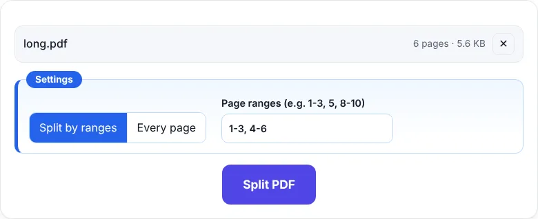

Have one big PDF and need only a few pages, or each page as its own file? You can **split a PDF** for free in your browser. Choose the file, type the pages you want (or pick every page) and download the parts. No sign-up and no watermark.

## When do you need to split a PDF?

Some common reasons:

- **Online forms** ask for each document separately, but you scanned everything into one PDF.
- **A bank statement or report** has many pages, and you need to send only one month or one section.
- **A scanned book or notes** is too big to upload, so you break it into chapters.
- **An office file** has many invoices or letters in one PDF, and each one must go to a different person.

## How to split a PDF (step by step)

1. Open **[Split PDF](/split-pdf/)**.
2. Click **Choose PDF file** or drag your PDF into the box. The tool shows how many pages the file has.
3. Choose how to split:
   - **Split by ranges** to make files from groups of pages.
   - **Every page** to make one PDF for each page.
4. If you chose ranges, type them in the **Page ranges** box, for example `1-3, 5, 8-10`.
5. Click **Split PDF**.
6. Click **Download PDF** (one file) or **Download all (ZIP)** (several files). You can also download any single part from the list.

The tool fills in a starting range for you that cuts the file into two halves. Change it to whatever you need.

## How to type page ranges

Each range you type becomes its own PDF file. Separate ranges with commas.

| You type | What you get |
|---|---|
| `1-3` | One PDF with pages 1, 2 and 3 |
| `1-3, 4-6` | Two PDFs: pages 1 to 3 and pages 4 to 6 |
| `2, 5, 9` | Three PDFs, each with one page |
| `1-2, 5-end` | Two PDFs: pages 1 to 2, and page 5 to the last page |
| Every page (button) | One PDF for every page, in a ZIP |

A few tips:

- `end` means the last page, so you do not need to count the pages.
- If you type a page number bigger than the file, the tool tells you how many pages the PDF has.
- The files are named after the pages they hold, for example `report-pages-1-3.pdf` or `report-page-5.pdf`, so they are easy to tell apart.

## Split, Extract or Remove: which tool to use?

ZentaPDF has three tools that look similar. Pick the one that matches what you want at the end:

| What you want | Best tool |
|---|---|
| Several separate files from one PDF | [Split PDF](/split-pdf/) |
| One new PDF with only the pages you pick | [Extract Pages](/extract-pages/) |
| The same PDF without a few unwanted pages | [Remove Pages](/remove-pages/) |
| Join the parts back into one file | [Merge PDF](/merge-pdf/) |

If you need to delete a few blank or wrong pages instead, see the guide on [how to remove pages from a PDF](/guides/how-to-remove-pages-from-pdf/).

## Splitting a PDF on a phone

Split PDF works in Chrome on Android and in Safari or Chrome on iPhone. You do not need to install an app.

1. Open [zentapdf.com/split-pdf/](/split-pdf/) and tap **Choose PDF file**.
2. Pick the PDF from your Files app, Downloads or WhatsApp documents.
3. Tap **Split by ranges** or **Every page**, then tap **Split PDF**.
4. Tap the download button.

When you get a ZIP file:

- **Android:** open the ZIP in your Files app and tap **Extract**. The menu name can be a little different on some phones.
- **iPhone:** open the ZIP in the Files app and tap it once. It unzips into a folder next to it.

If you need only one part, it is often easier to tap **Download** next to that file in the list instead of downloading the whole ZIP.

## Does splitting reduce quality or size?

Quality stays the same. The pages are copied as they are, so text stays sharp and searchable, and links keep working.

Each part is smaller than the original because it has fewer pages. But a part with scanned pages or photos can still be large. If a portal asks for a smaller file, run the part through [Compress PDF](/compress-pdf/). The guide on [compressing a PDF for email](/guides/how-to-compress-pdf-for-email/) explains what to do when a file is still too big.

## Common problems and fixes

- **"Please choose a PDF file."** The file you picked is not a PDF. If it is a photo, convert it first with [JPG to PDF](/jpg-to-pdf/).
- **The PDF asks for a password.** Open it with the password you know in [Unlock PDF](/unlock-pdf/), then split the unlocked copy.
- **"is outside this PDF".** You typed a page number that does not exist. Check the page count shown next to the file name.
- **Pages are in the wrong order.** Fix the order first with [Reorder Pages](/reorder-pdf-pages/), then split.
- **A portal still rejects the file.** Every portal has its own rules for file type, size and pages. Read the upload instructions on that portal and follow them.
