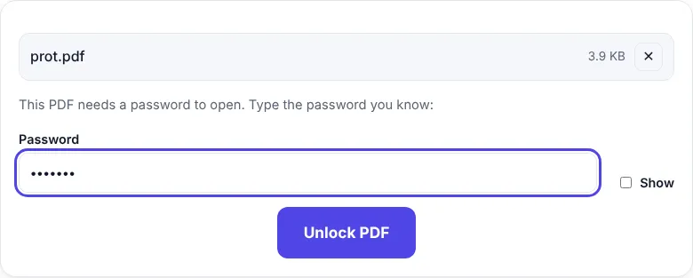

Bank statements, credit card bills, payslips, insurance policies and tax documents often arrive as **password-protected PDFs**. That's good for security, but annoying when you need to open them often, merge them, or upload them to a portal that can't accept protected files. If you know the password, you can save an unlocked copy in under a minute.

## Two kinds of PDF protection

| Type | What you see | How to unlock |
|---|---|---|
| **Open password** | The PDF asks for a password before showing anything | Type the password you know |
| **Permissions only** | It opens, but printing, copying or editing is blocked | Unlocks without a password |

## How to unlock a PDF

1. Open **[Unlock PDF](/unlock-pdf/)**.
2. Choose the protected PDF.
3. If it has an open password, type it (tick **Show** to check typing).
4. Click **Unlock PDF**.
5. Click **Download PDF**, the new copy opens without a password.

If the file only had printing/copying restrictions, they are removed straight away, without asking for a password.

## Finding the password for bank and card statements

Banks and card issuers usually explain the password format in the **email that came with the statement** or on their website. It is often built from details such as part of your **name**, your **date of birth** or a **customer ID**, but every bank uses its own format, so check the email carefully, including capital letters.

## When you might need an unlocked copy

- **Loan, visa and rental applications**, many portals reject protected PDFs.
- **Merging statements**, combine several months into one file with [Merge PDF](/merge-pdf/).
- **Making the file smaller**, [Compress PDF](/compress-pdf/) needs an unlocked file.
- **Sending to your accountant**, so they don't need your password.

## Keep unlocked copies safe

An unlocked statement can be opened by anyone who gets the file. So:

- Store unlocked copies in a **private folder**, not on shared computers.
- Don't email unlocked statements unless necessary.
- If you must share one, **add your own password** with [Protect PDF](/protect-pdf/) and send the password separately.
- Delete unlocked copies you no longer need.

## Is it legal?

Removing a password from **your own documents**, or files you have permission to use, is fine. Don't try to unlock documents you aren't allowed to open or change. ZentaPDF only works when you **know the password**; it does not crack or guess passwords.

## Troubleshooting

| Message | What to do |
|---|---|
| "That password is not correct" | Check capital letters, date format (DDMM vs DDMMYYYY) and the email from your bank |
| PDF opens but can't be printed | Use Unlock PDF, permission locks are removed without a password |
| File still asks for a password | Make sure you opened the downloaded *unlocked* copy |

