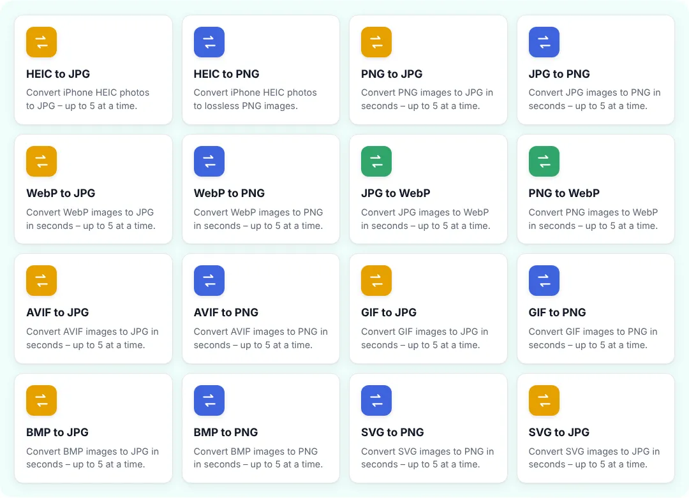

Choosing the wrong image format can make a website slow, a logo blurry, or a form upload fail. The good news: there are really only four formats you need to know.

## Quick comparison

| | JPG | PNG | WebP | AVIF |
|---|---|---|---|---|
| Compression | Lossy | Lossless | Lossy or lossless | Lossy or lossless |
| Size for a photo | Small | Very large | Smaller than JPG | Smallest |
| Transparency | No | Yes | Yes | Yes |
| Animation | No | No | Yes | Yes |
| Opens everywhere? | Yes | Yes | Almost | Not always |

## JPG (JPEG)

The classic photo format, used since the 1990s.

- **Good for:** photos, scans, social media, email, online forms.
- **Not good for:** logos, screenshots with small text (edges get blurry), anything needing transparency.
- **Tip:** quality 80–90% is usually indistinguishable from the original.

## PNG

Lossless — it keeps every pixel exactly.

- **Good for:** logos, icons, screenshots, diagrams, images with transparent backgrounds.
- **Not good for:** photos (files are 5–10× bigger than JPG).
- **Tip:** if a PNG photo is too big, [convert it to JPG](/png-to-jpg/).

## WebP

A modern format created by Google, supported by all current browsers.

- **Good for:** websites and blogs — typically **25–35% smaller** than JPG or PNG at similar quality, with transparency support.
- **Not good for:** older software that can't open it (some desktop apps and upload forms).
- **Tip:** saved a WebP from a website and can't open it? Use [WebP to JPG](/webp-to-jpg/).

## AVIF

The newest format, with the best compression.

- **Good for:** modern websites that want the fastest loading images.
- **Not good for:** sharing with people or apps that might not support it.

## Which one should I use?

| Situation | Best format |
|---|---|
| Phone photo to share or email | JPG |
| Photo for an online application form | JPG |
| Logo with transparent background | PNG (or WebP for websites) |
| Screenshot with text | PNG |
| Images on your website or blog | WebP |
| Maximum speed on a modern website | AVIF (with JPG/WebP fallback) |
| Printing | High-quality JPG or PNG |

## How to convert between formats

ZentaPDF has a converter for every common pair — for example [PNG to JPG](/png-to-jpg/), [JPG to PNG](/jpg-to-png/), [JPG to WebP](/jpg-to-webp/), [WebP to PNG](/webp-to-png/) and [AVIF to JPG](/avif-to-jpg/). See them all in [Image Converters](/image-converter/), or use [Convert Image](/convert-image/) to choose the output format yourself.

To make a file smaller **without** changing format, use [Compress Image](/compress-image/).

## Lossy vs lossless, simply explained

- **Lossless** (PNG, and optionally WebP/AVIF) keeps every pixel exactly. Edit and save it 100 times — nothing changes.
- **Lossy** (JPG, and usually WebP/AVIF) throws away details your eye barely notices to make files much smaller. Each re-save loses a little more, so always edit from the original.

## What about GIF, BMP, HEIC and SVG?

| Format | What it is | What to do |
|---|---|---|
| **GIF** | Old format for simple animations, max 256 colours | Use for small animations only; convert stills with [GIF to PNG](/gif-to-png/) |
| **BMP** | Old uncompressed Windows format, huge files | Convert with [BMP to JPG](/bmp-to-jpg/) |
| **HEIC** | iPhone photo format | Change iPhone camera setting to *Most Compatible* to get JPG |
| **SVG** | Vector graphics (logos, icons) that scale to any size | Keep for websites; convert with [SVG to PNG](/svg-to-png/) for documents |

## Image formats and website speed

Images are usually the heaviest part of a web page. Switching from JPG/PNG to **WebP** often makes pages load noticeably faster and can improve your Google PageSpeed score. A simple workflow for bloggers:

1. Resize photos to the width your site displays (often 1200–1600 px) with [Resize Image](/resize-image/).
2. Convert to WebP with [JPG to WebP](/jpg-to-webp/) at 75–85% quality.
3. Upload and add descriptive **alt text** for SEO and accessibility.

## A note on quality

Converting from a lossy format (JPG) to a lossless one (PNG) **won't bring back lost detail** — it only makes the file bigger. Always keep your original photos, and convert copies.

Pick the format for the job, and your images will look good and load fast.
