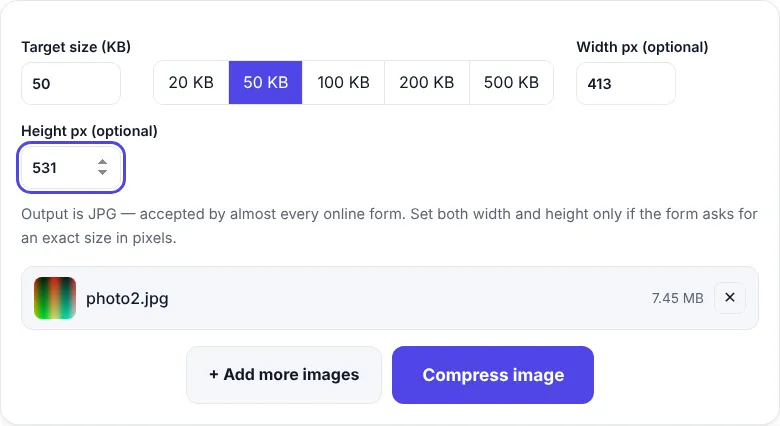

"Upload a recent passport-size photograph" — almost every Indian application form asks for it: exams, jobs, bank accounts, admissions, scholarships and many government services. But the rules about **size in cm, pixels and KB** can be confusing. This guide explains them simply and shows how to prepare the photo for free.

> **Rules differ between portals.** Always read the official instructions of the form you are filling. Use the numbers below as a starting point.

## Passport size in cm, mm and inches

The common passport-size photo in India is:

| Unit | Size |
|---|---|
| Centimetres | 3.5 × 4.5 cm |
| Millimetres | 35 × 45 mm |
| Inches | about 1.38 × 1.77 in |
| Pixels at 300 DPI | about **413 × 531 px** |
| Pixels at 200 DPI | about **276 × 354 px** |

Some online portals ask for a **different digital size** — for example a square photo or a specific pixel size. If the form gives pixels, use exactly those.

## How to convert cm to pixels

**pixels = cm ÷ 2.54 × DPI**

Example at 300 DPI: 3.5 cm ÷ 2.54 × 300 ≈ **413 px**; 4.5 cm ÷ 2.54 × 300 ≈ **531 px**.

## Typical KB limits

Online forms limit the **file size** too, for example:

| Form type | Typical photo limit |
|---|---|
| Competitive exams | often 20–50 KB |
| Job and bank applications | often 20–100 KB |
| Other government portals | often up to 100–300 KB |

Some forms also have a **minimum** (for example "at least 20 KB"), so a very small file can be rejected too.

## What makes a good passport photo

- **Plain white or light background**, no patterns or shadows.
- **Face straight** to the camera, both ears visible if possible, eyes open, neutral expression.
- Face fills about **60–75%** of the photo height.
- **Even light**, no harsh shadows; no filters or beauty effects.
- Recent photo; glasses only if the rules allow them, and without glare.

## Step-by-step: prepare your photo for free

1. **Take the photo** against a light wall in daylight, from about 1–1.5 m away.
2. **iPhone photo in HEIC?** Convert it with [HEIC to JPG](/heic-to-jpg/).
3. **Crop** with [Crop Image](/crop-image/). For 3.5 × 4.5 cm, use the **3:4** ratio (close to 35:45) and keep head and shoulders centred.
4. **Set size and KB:** open [Reduce Image Size in KB](/reduce-image-size-in-kb/), type the target (e.g. **50 KB**) and the pixels the form asks for (e.g. **413 × 531**), then click **Compress**.
5. **Check** the downloaded JPG: face sharp, background clean, size under the limit.

Shortcuts: [Compress to 20 KB](/compress-image-to-20kb/) · [50 KB](/compress-image-to-50kb/) · [100 KB](/compress-image-to-100kb/)

## Printing passport photos at home

If you need prints, place several 3.5 × 4.5 cm photos on an A4 page in any document editor, set the image size in cm, and print on photo paper at 100% scale ("actual size"). Make sure the printer doesn't "fit to page", or the size will change.

## Why photos get rejected

| Reason | Fix |
|---|---|
| File too large or too small | Change the KB target |
| Wrong format (PNG/HEIC) | Our tools save JPG |
| Wrong pixel size | Type the exact width and height |
| Face too small / too large | Crop again with more or less margin |
| Dark or coloured background | Retake against a light wall |
| Blurry | Use a sharper original; don't compress twice |

## Keep a master copy

Save one **high-quality, uncompressed** photo of yourself. Every time a form asks for a different size, make a new copy from the master — never re-compress an already small file.

