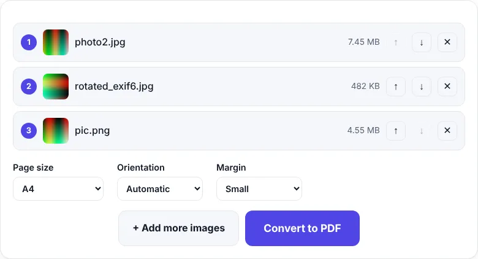

You don't need a scanner to send a document as a PDF. Your phone camera, combined with a free app or a browser tool, makes clean scans in seconds — good enough for job applications, college forms, insurance claims and expense reports.

## Option 1 – Use the scanner already on your phone

### Android: Google Drive

1. Open the **Google Drive** app.
2. Tap **+** → **Scan**.
3. Point at the document; tap the shutter.
4. Adjust the corners, choose a filter (**Black & white** for text), and add more pages with **+**.
5. Tap **Save** — Drive saves a PDF.

Many Android phones also have a document mode in the camera or the Files app.

### iPhone and iPad: Notes or Files

1. Open **Notes** → new note → camera icon → **Scan Documents** (or Files → ••• → **Scan Documents**).
2. Hold the phone over the page — it captures automatically when the page is detected.
3. Tap **Save**. Use **Share** to send the PDF or save it to Files.

## Option 2 – Take photos and convert them to PDF

Already have photos of the pages? Turn them into one PDF:

1. Open **[Images to PDF](/images-to-pdf/)**.
2. Tap **Choose images** and select the photos in page order.
3. Choose **A4**, **Automatic** orientation and a **Small** margin.
4. Tap **Convert to PDF** and download.

Photos from iPhones in HEIC format work too.

## Tips for clear, readable scans

| Do | Don't |
|---|---|
| Use daylight or bright, even light | Use flash — it causes a white glare |
| Place the paper on a dark, plain surface | Scan on a patterned bedsheet |
| Hold the phone straight above the page | Shoot at an angle |
| Fill the frame with the page | Leave lots of table visible |
| Use "Black & white" for text documents | Use colour for plain text — files get larger |

## After scanning: fix and finish

- **Page sideways?** [Rotate PDF](/rotate-pdf/).
- **Several PDFs?** Join them with [Merge PDF](/merge-pdf/).
- **Wrong order?** [Reorder Pages](/reorder-pdf-pages/).
- **Too big to upload?** [Compress PDF](/compress-pdf/) — see [how to compress a PDF to 100 KB](/guides/compress-pdf-to-100kb/).
- **Needs a signature?** [Sign PDF](/sign-pdf/).

## Which scan settings for which document?

| Document | Mode | Notes |
|---|---|---|
| Typed letter, form | Black & white | Smallest file, very readable |
| Certificate with seal/stamp | Colour | Keep the coloured seal visible |
| Photo ID (Aadhaar, PAN) | Colour | Check that numbers are sharp |
| Receipts | Black & white | Thermal receipts fade — scan soon |

